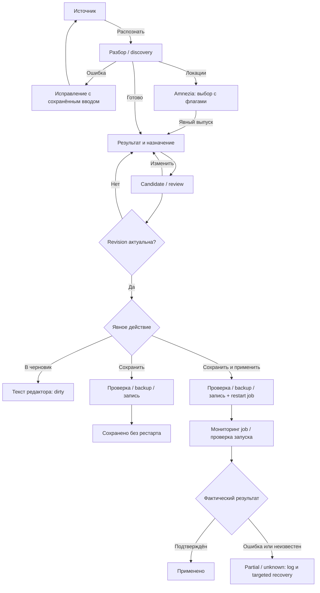

# Mihomo: поэтапный план редизайна модала «Узел»

**Статус:** продуктовые решения раздела 10 согласованы; Этапы 0–5 закрыты 26 октября 2026 года, Этапы 6–9 ещё не выполнены. Дополнение от 26 октября: сохранение и применение из модала, обязательный Operator-стиль и сохранение флагов Amnezia.
**Дата:** 26 октября 2026 года. **База:** `pre-release`, коммит `0eece0ce`.

> Этапы 0–5 выполнены: baseline, UX-контракт, state/API boundary, компактный source/lifecycle и безопасные result cards уже реализованы. Save/apply пока не реализованы. Макеты ниже — предлагаемые состояния с демонстрационными данными, не скриншоты работающего приложения. Галочки в макетах показывают выбор пользователя, а не завершённые работы.

## 1. Кратко: что меняем

**Цель:** вместо большого пустого YAML-окна сделать понятное добавление узлов и подписок, не потеряв существующие способы импорта.

| Сейчас | Предлагается |
| --- | --- |
| `Mihomo Premium Import`, смешанные русские и английские подписи | «Добавить узлы в Mihomo», единая терминология |
| Пустой preview занимает половину модала | Компактный источник; результат появляется после распознавания |
| `Преобразовать` / `В proxies` / `Вставить в конфиг` одновременно | «Распознать» на входе; в финале три явно названных способа завершения |
| Группы выбираются до распознавания | Группы и параметры показываются после определения способа добавления |
| Результат приходится читать в YAML | Карточки, количество, предупреждения, итог изменений |
| Выбор CodeMirror/Monaco постоянно виден | Общая настройка сохраняется; редактор загружается при раскрытии YAML |

**Рекомендуемая последовательность пользователя:** источник → результат и настройки → проверка → выбранное действие: в черновик / сохранить / сохранить и применить. Настройки не обязательно выделять в отдельный экран: простой узел должен добавляться без лишних переходов.

**Подтверждённое расширение:** полный сценарий можно закончить в модале, без перехода в главный редактор:

| Действие в финальном шаге | Эффект |
| --- | --- |
| **В черновик** | Добавить узлы в текст редактора; файл на роутере и runtime не менять |
| **Сохранить** | Проверить полный candidate, создать backup и сохранить `config.yaml`; явно передать `restart: false`, не наследовать глобальное «авторестарт после сохранения» |
| **Сохранить и применить** | Проверить полный candidate, создать backup, сохранить файл, запустить существующий restart job и показать фактический результат в этом же модале |

Распознавание и переходы по шагам по-прежнему ничего автоматически не сохраняют и не перезапускают. Главный редактор синхронизируется с результатом, но открывать его для завершения операции не требуется.

**Важно при несохранённых правках:** сохранение запишет полный итоговый конфиг, включая сделанные ранее правки главного редактора. Перед действием показываем это явно; нельзя незаметно применить только новый узел или потерять остальные изменения. Отдельный diff «Импорт» не заменяет diff «Будет сохранено относительно файла на роутере».

## 2. Предлагаемые экраны

Первые макеты были упрощёнными wireframes; они не предписывали белые поля, крупные заголовки или синие поверхности. Ниже они уточнены как статические Operator-наброски: нейтральные поверхности, тонкие разделители и фиолетовый primary action. Цвета взяты из текущего `xkeen-ui/static/panel-operator.css`; это всё ещё не pixel-perfect production-компоненты. Для геометрии и флагов используется Pencil, поскольку Balsamiq не воспроизводит наши controls и SVG-ассеты точно.

**Обязательный визуальный контракт реализации:**

- используем действующие `--op-*` tokens, типографику, радиусы, размеры controls, focus/hover/disabled/busy states и `op_icon`/operator icon system;
- существующий modal manager, header/body/sticky-footer, скролл и поведение на узком экране; без отдельной «премиальной» темы;
- обе темы dark/light, включая YAML canvas и ошибки; цвета макета не копируются в production как hardcoded overrides;
- текущие SVG-флаги стран через `mihomoCountryFlag` → `countryFlag`, не emoji как единственный вариант и не новые сетевые ресурсы;
- перед основной реализацией — отдельная проверка реального HTML/CSS-макета на существующих компонентах панели. Статические схемы ниже подтверждают сценарий, но не заменяют её.

В preview макеты показаны напрямую; Markdown хранит их редактируемое описание. Все адреса, числа, прогресс и результаты в макетах демонстрационные.

### 2.1. Источник

В начале видны только источник, необязательное ручное указание формата и кнопка «Распознать». Поле принимает несколько proxy-ссылок; многострочный VPN-конфиг разбирается целиком, а не по строкам.

```pencil
{ "version": "2.21", "children": [
{"id": "mockup-20", "type": "frame", "width": 880, "height": 500, "layout": "none", "clip": true, "fill": "#14171c", "children": [
  {"id": "node-1", "type": "rectangle", "x": 0, "y": 0, "width": 880, "height": 500, "fill": "#14171c", "stroke": "#2a2f38", "strokeWidth": 1, "cornerRadius": 12},
  {"id": "node-2", "type": "rectangle", "x": 0, "y": 62, "width": 880, "height": 1, "fill": "#2a2f38"},
  {"id": "text-3", "type": "text", "x": 28, "y": 27, "width": 430, "height": 34, "content": "Добавить узлы в Mihomo", "fontSize": 15, "fontWeight": "600", "fill": "#e8eaf0"},
  {"id": "button-4", "type": "frame", "x": 810, "y": 20, "width": 42, "height": 34, "layout": "none", "fill": "#1a1e25", "stroke": "#2a2f38", "strokeWidth": 1, "cornerRadius": 6, "children": [{"id": "text-5", "type": "text", "x": 6, "y": 8.0, "width": 30, "height": 18, "content": "×", "fontSize": 13, "fontWeight": "400", "fill": "#e8eaf0", "textAlign": "center"}]},
  {"id": "text-6", "type": "text", "x": 30, "y": 69, "width": 640, "height": 26, "content": "Ссылка, подписка, ключ Amnezia или VPN-конфигурация. Сначала — распознавание.", "fontSize": 13, "fontWeight": "400", "fill": "#969da9"},
  {"id": "node-7", "type": "rectangle", "x": 28, "y": 112, "width": 824, "height": 300, "fill": "#1a1e25", "stroke": "#2a2f38", "strokeWidth": 1, "cornerRadius": 6},
  {"id": "text-8", "type": "text", "x": 52, "y": 141, "width": 180, "height": 24, "content": "Источник", "fontSize": 14, "fontWeight": "600", "fill": "#e8eaf0"},
  {"id": "node-9", "type": "rectangle", "x": 52, "y": 168, "width": 300, "height": 38, "fill": "#0d0f13", "stroke": "#2a2f38", "strokeWidth": 1, "cornerRadius": 6},
  {"id": "text-10", "type": "text", "x": 62, "y": 178, "width": 268, "height": 26, "content": "Авто — определить автоматически", "fontSize": 13, "fontWeight": "400", "fill": "#e8eaf0"},
  {"id": "text-11", "type": "text", "x": 327, "y": 177, "width": 17, "height": 20, "content": "⌄", "fontSize": 13, "fontWeight": "400", "fill": "#969da9"},
  {"id": "text-12", "type": "text", "x": 52, "y": 231, "width": 360, "height": 22, "content": "Ссылка, ключ или конфигурация", "fontSize": 13, "fontWeight": "400", "fill": "#e8eaf0"},
  {"id": "node-13", "type": "rectangle", "x": 52, "y": 252, "width": 776, "height": 112, "fill": "#0d0f13", "stroke": "#2a2f38", "strokeWidth": 1, "cornerRadius": 6},
  {"id": "text-14", "type": "text", "x": 62, "y": 262, "width": 744, "height": 100, "content": "vless://...\nили\nhttps://...", "fontSize": 13, "fontWeight": "400", "fill": "#e8eaf0"},
  {"id": "text-15", "type": "text", "x": 52, "y": 381, "width": 700, "height": 22, "content": "Не сохраняем config.yaml и не перезапускаем Mihomo на этом шаге.", "fontSize": 12, "fontWeight": "400", "fill": "#969da9"},
  {"id": "button-16", "type": "frame", "x": 650, "y": 438, "width": 92, "height": 36, "layout": "none", "fill": "#1a1e25", "stroke": "#2a2f38", "strokeWidth": 1, "cornerRadius": 6, "children": [{"id": "text-17", "type": "text", "x": 6, "y": 9.0, "width": 80, "height": 18, "content": "Отмена", "fontSize": 13, "fontWeight": "400", "fill": "#e8eaf0", "textAlign": "center"}]},
  {"id": "button-18", "type": "frame", "x": 750, "y": 438, "width": 102, "height": 36, "layout": "none", "fill": "#7477e8", "stroke": "#7477e8", "strokeWidth": 1, "cornerRadius": 6, "children": [{"id": "text-19", "type": "text", "x": 6, "y": 9.0, "width": 90, "height": 18, "content": "Распознать", "fontSize": 13, "fontWeight": "600", "fill": "#f7f7f9", "textAlign": "center"}]}
]}
]}
```


### 2.2. Результат одного узла и группы

Прямой VLESS-узел добавляется в `proxies`. Для него нельзя предлагать создание HTTP-provider без источника подписки. Результат разбора не означает, что сервер доступен: задержка и подключение здесь не проверяются.

```pencil
{ "version": "2.21", "children": [
{"id": "mockup-50", "type": "frame", "width": 980, "height": 570, "layout": "none", "clip": true, "fill": "#14171c", "children": [
  {"id": "node-21", "type": "rectangle", "x": 0, "y": 0, "width": 980, "height": 570, "fill": "#14171c", "stroke": "#2a2f38", "strokeWidth": 1, "cornerRadius": 12},
  {"id": "node-22", "type": "rectangle", "x": 0, "y": 62, "width": 980, "height": 1, "fill": "#2a2f38"},
  {"id": "text-23", "type": "text", "x": 28, "y": 27, "width": 500, "height": 34, "content": "Результат распознавания", "fontSize": 15, "fontWeight": "600", "fill": "#e8eaf0"},
  {"id": "text-24", "type": "text", "x": 30, "y": 75, "width": 700, "height": 28, "content": "Локально распознан 1 узел · доступность сервера не проверялась", "fontSize": 14, "fontWeight": "400", "fill": "#6fd3a8"},
  {"id": "node-25", "type": "rectangle", "x": 28, "y": 116, "width": 520, "height": 205, "fill": "#1a1e25", "stroke": "#2a2f38", "strokeWidth": 1, "cornerRadius": 6},
  {"id": "text-26", "type": "text", "x": 50, "y": 145, "width": 450, "height": 26, "content": "Germany-01", "fontSize": 14, "fontWeight": "600", "fill": "#e8eaf0"},
  {"id": "text-27", "type": "text", "x": 50, "y": 183, "width": 450, "height": 78, "content": "example.com:443\nTLS · Reality · TCP\nКонфликт имени не обнаружен", "fontSize": 13, "fontWeight": "400", "fill": "#e8eaf0"},
  {"id": "button-28", "type": "frame", "x": 50, "y": 264, "width": 130, "height": 32, "layout": "none", "fill": "#1a1e25", "stroke": "#2a2f38", "strokeWidth": 1, "cornerRadius": 6, "children": [{"id": "text-29", "type": "text", "x": 6, "y": 7.0, "width": 118, "height": 18, "content": "Изменить имя", "fontSize": 13, "fontWeight": "400", "fill": "#e8eaf0", "textAlign": "center"}]},
  {"id": "node-30", "type": "rectangle", "x": 570, "y": 116, "width": 382, "height": 270, "fill": "#1a1e25", "stroke": "#2a2f38", "strokeWidth": 1, "cornerRadius": 6},
  {"id": "text-31", "type": "text", "x": 594, "y": 145, "width": 300, "height": 24, "content": "Куда добавить", "fontSize": 14, "fontWeight": "600", "fill": "#e8eaf0"},
  {"id": "text-32", "type": "text", "x": 594, "y": 179, "width": 320, "height": 30, "content": "Статический узел → proxies", "fontSize": 13, "fontWeight": "400", "fill": "#e8eaf0"},
  {"id": "button-33", "type": "frame", "x": 644, "y": 506, "width": 110, "height": 36, "layout": "none", "fill": "#1a1e25", "stroke": "#2a2f38", "strokeWidth": 1, "cornerRadius": 6, "children": [{"id": "text-34", "type": "text", "x": 6, "y": 9.0, "width": 98, "height": 18, "content": "Назад", "fontSize": 13, "fontWeight": "400", "fill": "#e8eaf0", "textAlign": "center"}]},
  {"id": "button-35", "type": "frame", "x": 766, "y": 506, "width": 186, "height": 36, "layout": "none", "fill": "#7477e8", "stroke": "#7477e8", "strokeWidth": 1, "cornerRadius": 6, "children": [{"id": "text-36", "type": "text", "x": 6, "y": 9.0, "width": 174, "height": 18, "content": "Проверить изменение", "fontSize": 13, "fontWeight": "600", "fill": "#f7f7f9", "textAlign": "center"}]},
  {"id": "text-37", "type": "text", "x": 594, "y": 219, "width": 310, "height": 24, "content": "Добавить в группы", "fontSize": 13, "fontWeight": "600", "fill": "#e8eaf0"},
  {"id": "node-38", "type": "rectangle", "x": 594, "y": 254.0, "width": 14, "height": 14, "fill": "#7477e8", "stroke": "#2a2f38", "strokeWidth": 1, "cornerRadius": 3},
  {"id": "text-39", "type": "text", "x": 595, "y": 253.0, "width": 12, "height": 16, "content": "✓", "fontSize": 12, "fontWeight": "600", "fill": "#f7f7f9"},
  {"id": "text-40", "type": "text", "x": 618, "y": 252.0, "width": 294, "height": 18, "content": "Auto-Fallback", "fontSize": 13, "fontWeight": "400", "fill": "#e8eaf0"},
  {"id": "node-41", "type": "rectangle", "x": 594, "y": 288.0, "width": 14, "height": 14, "fill": "#7477e8", "stroke": "#2a2f38", "strokeWidth": 1, "cornerRadius": 3},
  {"id": "text-42", "type": "text", "x": 595, "y": 287.0, "width": 12, "height": 16, "content": "✓", "fontSize": 12, "fontWeight": "600", "fill": "#f7f7f9"},
  {"id": "text-43", "type": "text", "x": 618, "y": 286.0, "width": 294, "height": 18, "content": "Ru-Traffic", "fontSize": 13, "fontWeight": "400", "fill": "#e8eaf0"},
  {"id": "text-44", "type": "text", "x": 594, "y": 329, "width": 318, "height": 24, "content": "Выбрано: 2 группы", "fontSize": 13, "fontWeight": "400", "fill": "#969da9"},
  {"id": "text-45", "type": "text", "x": 28, "y": 421, "width": 924, "height": 42, "content": "На финальном шаге: в черновик, сохранить или сохранить и применить из модала.", "fontSize": 13, "fontWeight": "400", "fill": "#969da9"},
  {"id": "button-46", "type": "frame", "x": 202, "y": 264, "width": 170, "height": 36, "layout": "none", "fill": "#1a1e25", "stroke": "#2a2f38", "strokeWidth": 1, "cornerRadius": 6, "children": [{"id": "text-47", "type": "text", "x": 6, "y": 9.0, "width": 158, "height": 18, "content": "Показать YAML", "fontSize": 13, "fontWeight": "400", "fill": "#e8eaf0", "textAlign": "center"}]},
  {"id": "button-48", "type": "frame", "x": 910, "y": 22, "width": 42, "height": 36, "layout": "none", "fill": "#1a1e25", "stroke": "#2a2f38", "strokeWidth": 1, "cornerRadius": 6, "children": [{"id": "text-49", "type": "text", "x": 6, "y": 9.0, "width": 30, "height": 18, "content": "×", "fontSize": 13, "fontWeight": "400", "fill": "#e8eaf0", "textAlign": "center"}]}
]}
]}
```


### 2.3. Подписка: способ добавления

Два способа хранения: динамический `proxy-provider` и статические `proxies`. Автообновление панелью — дополнительная возможность статического импорта, а не третий взаимоисключающий режим. Показываем только реально поддержанные источником варианты.

Для provider важна не только вставка в `proxy-providers`, но и подключение к группам через `use`. Для статических узлов группы получают имена через `proxies`. Это разные операции.

```pencil
{ "version": "2.21", "children": [
{"id": "mockup-78", "type": "frame", "width": 980, "height": 580, "layout": "none", "clip": true, "fill": "#14171c", "children": [
  {"id": "node-51", "type": "rectangle", "x": 0, "y": 0, "width": 980, "height": 580, "fill": "#14171c", "stroke": "#2a2f38", "strokeWidth": 1, "cornerRadius": 12},
  {"id": "node-52", "type": "rectangle", "x": 0, "y": 62, "width": 980, "height": 1, "fill": "#2a2f38"},
  {"id": "text-53", "type": "text", "x": 28, "y": 27, "width": 820, "height": 38, "content": "Подписка: способ добавления", "fontSize": 14, "fontWeight": "600", "fill": "#e8eaf0"},
  {"id": "button-54", "type": "frame", "x": 910, "y": 22, "width": 42, "height": 36, "layout": "none", "fill": "#1a1e25", "stroke": "#2a2f38", "strokeWidth": 1, "cornerRadius": 6, "children": [{"id": "text-55", "type": "text", "x": 6, "y": 9.0, "width": 30, "height": 18, "content": "×", "fontSize": 13, "fontWeight": "400", "fill": "#e8eaf0", "textAlign": "center"}]},
  {"id": "text-56", "type": "text", "x": 28, "y": 85, "width": 900, "height": 28, "content": "example.com · 37 узлов получено · 2 строки не поддерживаются", "fontSize": 13, "fontWeight": "400", "fill": "#969da9"},
  {"id": "node-57", "type": "rectangle", "x": 28, "y": 145.0, "width": 14, "height": 14, "fill": "#7477e8", "stroke": "#2a2f38", "strokeWidth": 1, "cornerRadius": 7},
  {"id": "text-58", "type": "text", "x": 29, "y": 144.0, "width": 12, "height": 16, "content": "•", "fontSize": 12, "fontWeight": "600", "fill": "#f7f7f9"},
  {"id": "text-59", "type": "text", "x": 52, "y": 143.0, "width": 900, "height": 18, "content": "Динамическая подписка (proxy-provider)", "fontSize": 13, "fontWeight": "400", "fill": "#e8eaf0"},
  {"id": "text-60", "type": "text", "x": 56, "y": 179, "width": 880, "height": 28, "content": "Mihomo обновляет provider. Группы используют ссылку use на его имя.", "fontSize": 13, "fontWeight": "400", "fill": "#969da9"},
  {"id": "node-61", "type": "rectangle", "x": 56, "y": 216, "width": 370, "height": 36, "fill": "#0d0f13", "stroke": "#2a2f38", "strokeWidth": 1, "cornerRadius": 6},
  {"id": "text-62", "type": "text", "x": 66, "y": 226, "width": 338, "height": 24, "content": "Имя provider: Example", "fontSize": 13, "fontWeight": "400", "fill": "#e8eaf0"},
  {"id": "node-63", "type": "rectangle", "x": 448, "y": 216, "width": 350, "height": 36, "fill": "#0d0f13", "stroke": "#2a2f38", "strokeWidth": 1, "cornerRadius": 6},
  {"id": "text-64", "type": "text", "x": 458, "y": 226, "width": 318, "height": 24, "content": "Обновление: каждые 24 ч", "fontSize": 13, "fontWeight": "400", "fill": "#e8eaf0"},
  {"id": "text-65", "type": "text", "x": 773, "y": 225, "width": 17, "height": 20, "content": "⌄", "fontSize": 13, "fontWeight": "400", "fill": "#969da9"},
  {"id": "node-66", "type": "rectangle", "x": 28, "y": 289.0, "width": 14, "height": 14, "fill": "#0d0f13", "stroke": "#2a2f38", "strokeWidth": 1, "cornerRadius": 7},
  {"id": "text-67", "type": "text", "x": 52, "y": 287.0, "width": 900, "height": 18, "content": "Статические узлы (proxies)", "fontSize": 13, "fontWeight": "400", "fill": "#e8eaf0"},
  {"id": "text-68", "type": "text", "x": 56, "y": 323, "width": 880, "height": 28, "content": "Разовая вставка или автообновление панелью, если адаптер его поддерживает.", "fontSize": 13, "fontWeight": "400", "fill": "#969da9"},
  {"id": "text-69", "type": "text", "x": 28, "y": 379, "width": 800, "height": 26, "content": "Подключить к группам", "fontSize": 14, "fontWeight": "600", "fill": "#e8eaf0"},
  {"id": "node-70", "type": "rectangle", "x": 28, "y": 419.0, "width": 14, "height": 14, "fill": "#7477e8", "stroke": "#2a2f38", "strokeWidth": 1, "cornerRadius": 3},
  {"id": "text-71", "type": "text", "x": 29, "y": 418.0, "width": 12, "height": 16, "content": "✓", "fontSize": 12, "fontWeight": "600", "fill": "#f7f7f9"},
  {"id": "text-72", "type": "text", "x": 52, "y": 417.0, "width": 876, "height": 18, "content": "Auto-Fallback → use: Example", "fontSize": 13, "fontWeight": "400", "fill": "#e8eaf0"},
  {"id": "text-73", "type": "text", "x": 28, "y": 463, "width": 924, "height": 32, "content": "Режимы доступны только при поддержке источника. Выбор статических узлов — в P2.", "fontSize": 12, "fontWeight": "400", "fill": "#969da9"},
  {"id": "button-74", "type": "frame", "x": 632, "y": 518, "width": 110, "height": 36, "layout": "none", "fill": "#1a1e25", "stroke": "#2a2f38", "strokeWidth": 1, "cornerRadius": 6, "children": [{"id": "text-75", "type": "text", "x": 6, "y": 9.0, "width": 98, "height": 18, "content": "Назад", "fontSize": 13, "fontWeight": "400", "fill": "#e8eaf0", "textAlign": "center"}]},
  {"id": "button-76", "type": "frame", "x": 754, "y": 518, "width": 198, "height": 36, "layout": "none", "fill": "#7477e8", "stroke": "#7477e8", "strokeWidth": 1, "cornerRadius": 6, "children": [{"id": "text-77", "type": "text", "x": 6, "y": 9.0, "width": 186, "height": 18, "content": "Проверить изменение", "fontSize": 13, "fontWeight": "600", "fill": "#f7f7f9", "textAlign": "center"}]}
]}
]}
```


### 2.4. Amnezia Premium: осознанный выпуск

Сохраняем существующий двухшаговый web-flow: сначала список локаций, затем явный выпуск только выбранных конфигураций. Не выпускаем конфиги автоматически при вставке ключа, повторном рендере или возврате на шаг.

**Флаги обязательны и уже есть в исходном интерфейсе.** Ряд: checkbox → компактный SVG-флаг → название страны → ISO-код. Сохраняем «Все / Снять», число выбранных локаций, компактный двухколоночный scroller на desktop и одну колонку на мобильном. Нет SVG для кода — используем безопасный fallback с ISO-кодом; доступное название страны остаётся текстом. Флаг не заменяет label и не определяет выбранность. Текущие helpers и E2E для flags сохраняются.

```pencil
{ "version": "2.21", "children": [
{"id": "mockup-214", "type": "frame", "width": 880, "height": 560, "layout": "none", "clip": true, "fill": "#14171c", "children": [
  {"id": "node-141", "type": "rectangle", "x": 0, "y": 0, "width": 880, "height": 560, "fill": "#14171c", "stroke": "#2a2f38", "strokeWidth": 1, "cornerRadius": 12},
  {"id": "node-142", "type": "rectangle", "x": 0, "y": 56, "width": 880, "height": 1, "fill": "#2a2f38"},
  {"id": "text-143", "type": "text", "x": 22, "y": 19, "width": 700, "height": 24, "content": "Добавить узлы в Mihomo", "fontSize": 15, "fontWeight": "600", "fill": "#f7f7f9"},
  {"id": "button-144", "type": "frame", "x": 826, "y": 13, "width": 32, "height": 32, "layout": "none", "fill": "#1a1e25", "stroke": "#2a2f38", "strokeWidth": 1, "cornerRadius": 6, "children": [{"id": "text-145", "type": "text", "x": 6, "y": 7.0, "width": 20, "height": 18, "content": "×", "fontSize": 13, "fontWeight": "400", "fill": "#e8eaf0", "textAlign": "center"}]},
  {"id": "text-146", "type": "text", "x": 22, "y": 75, "width": 820, "height": 22, "content": "Источник  /  Amnezia Premium  /  Локации", "fontSize": 13, "fontWeight": "400", "fill": "#969da9"},
  {"id": "text-147", "type": "text", "x": 22, "y": 114, "width": 480, "height": 24, "content": "Выберите локации", "fontSize": 14, "fontWeight": "600", "fill": "#f7f7f9"},
  {"id": "text-148", "type": "text", "x": 638, "y": 114, "width": 216, "height": 24, "content": "Выбрано 2 из 4", "fontSize": 13, "fontWeight": "400", "fill": "#6fd3a8"},
  {"id": "node-149", "type": "rectangle", "x": 22, "y": 150, "width": 836, "height": 62, "fill": "#1a1e25", "stroke": "#2a2f38", "strokeWidth": 1, "cornerRadius": 6},
  {"id": "text-150", "type": "text", "x": 36, "y": 163, "width": 794, "height": 20, "content": "Ключ скрыт. Выпуск отправит его сервису Amnezia.", "fontSize": 13, "fontWeight": "400", "fill": "#e8eaf0"},
  {"id": "text-151", "type": "text", "x": 36, "y": 187, "width": 794, "height": 20, "content": "Получение списка не выпускает конфиги. Выпуск — только по вашей кнопке.", "fontSize": 12, "fontWeight": "400", "fill": "#969da9"},
  {"id": "text-152", "type": "text", "x": 22, "y": 234, "width": 440, "height": 24, "content": "Доступные серверы", "fontSize": 13, "fontWeight": "600", "fill": "#e8eaf0"},
  {"id": "button-153", "type": "frame", "x": 698, "y": 229, "width": 74, "height": 28, "layout": "none", "fill": "#1a1e25", "stroke": "#2a2f38", "strokeWidth": 1, "cornerRadius": 6, "children": [{"id": "text-154", "type": "text", "x": 6, "y": 5.0, "width": 62, "height": 18, "content": "Все", "fontSize": 13, "fontWeight": "400", "fill": "#e8eaf0", "textAlign": "center"}]},
  {"id": "button-155", "type": "frame", "x": 784, "y": 229, "width": 74, "height": 28, "layout": "none", "fill": "#1a1e25", "stroke": "#2a2f38", "strokeWidth": 1, "cornerRadius": 6, "children": [{"id": "text-156", "type": "text", "x": 6, "y": 5.0, "width": 62, "height": 18, "content": "Снять", "fontSize": 13, "fontWeight": "400", "fill": "#e8eaf0", "textAlign": "center"}]},
  {"id": "node-157", "type": "rectangle", "x": 22, "y": 270, "width": 836, "height": 166, "fill": "#0d0f13", "stroke": "#2a2f38", "strokeWidth": 1, "cornerRadius": 6},
  {"id": "node-158", "type": "rectangle", "x": 38, "y": 292.0, "width": 14, "height": 14, "fill": "#7477e8", "stroke": "#2a2f38", "strokeWidth": 1, "cornerRadius": 3},
  {"id": "text-159", "type": "text", "x": 39, "y": 291.0, "width": 12, "height": 16, "content": "✓", "fontSize": 12, "fontWeight": "600", "fill": "#f7f7f9"},
  {"id": "text-160", "type": "text", "x": 62, "y": 290.0, "width": 1, "height": 18, "content": "", "fontSize": 13, "fontWeight": "400", "fill": "#e8eaf0"},
  {"id": "node-161", "type": "rectangle", "x": 68.0, "y": 292.0, "width": 20.0, "height": 14.0, "fill": "#ffce00"},
  {"id": "node-162", "type": "rectangle", "x": 68.0, "y": 292.0, "width": 20.0, "height": 9.333, "fill": "#dd0000"},
  {"id": "node-163", "type": "rectangle", "x": 68.0, "y": 292.0, "width": 20.0, "height": 4.667, "fill": "#000"},
  {"id": "text-164", "type": "text", "x": 100, "y": 292, "width": 254, "height": 22, "content": "Германия", "fontSize": 13, "fontWeight": "400", "fill": "#e8eaf0"},
  {"id": "text-165", "type": "text", "x": 368, "y": 292, "width": 46, "height": 22, "content": "DE", "fontSize": 12, "fontWeight": "400", "fill": "#969da9"},
  {"id": "node-166", "type": "rectangle", "x": 452, "y": 292.0, "width": 14, "height": 14, "fill": "#7477e8", "stroke": "#2a2f38", "strokeWidth": 1, "cornerRadius": 3},
  {"id": "text-167", "type": "text", "x": 453, "y": 291.0, "width": 12, "height": 16, "content": "✓", "fontSize": 12, "fontWeight": "600", "fill": "#f7f7f9"},
  {"id": "text-168", "type": "text", "x": 476, "y": 290.0, "width": 1, "height": 18, "content": "", "fontSize": 13, "fontWeight": "400", "fill": "#e8eaf0"},
  {"id": "node-169", "type": "rectangle", "x": 482.0, "y": 292.0, "width": 20.0, "height": 14.0, "fill": "#21468b"},
  {"id": "node-170", "type": "rectangle", "x": 482.0, "y": 292.0, "width": 20.0, "height": 9.333, "fill": "#fff"},
  {"id": "node-171", "type": "rectangle", "x": 482.0, "y": 292.0, "width": 20.0, "height": 4.667, "fill": "#ae1c28"},
  {"id": "text-172", "type": "text", "x": 514, "y": 292, "width": 254, "height": 22, "content": "Нидерланды", "fontSize": 13, "fontWeight": "400", "fill": "#e8eaf0"},
  {"id": "text-173", "type": "text", "x": 782, "y": 292, "width": 46, "height": 22, "content": "NL", "fontSize": 12, "fontWeight": "400", "fill": "#969da9"},
  {"id": "node-174", "type": "rectangle", "x": 38, "y": 339.0, "width": 14, "height": 14, "fill": "#0d0f13", "stroke": "#2a2f38", "strokeWidth": 1, "cornerRadius": 3},
  {"id": "text-175", "type": "text", "x": 62, "y": 337.0, "width": 1, "height": 18, "content": "", "fontSize": 13, "fontWeight": "400", "fill": "#e8eaf0"},
  {"id": "node-176", "type": "rectangle", "x": 68.0, "y": 339.0, "width": 20.0, "height": 14.0, "fill": "#dc143c"},
  {"id": "node-177", "type": "rectangle", "x": 68.0, "y": 339.0, "width": 20.0, "height": 7.0, "fill": "#fff"},
  {"id": "text-178", "type": "text", "x": 100, "y": 339, "width": 254, "height": 22, "content": "Польша", "fontSize": 13, "fontWeight": "400", "fill": "#e8eaf0"},
  {"id": "text-179", "type": "text", "x": 368, "y": 339, "width": 46, "height": 22, "content": "PL", "fontSize": 12, "fontWeight": "400", "fill": "#969da9"},
  {"id": "node-180", "type": "rectangle", "x": 452, "y": 339.0, "width": 14, "height": 14, "fill": "#0d0f13", "stroke": "#2a2f38", "strokeWidth": 1, "cornerRadius": 3},
  {"id": "text-181", "type": "text", "x": 476, "y": 337.0, "width": 1, "height": 18, "content": "", "fontSize": 13, "fontWeight": "400", "fill": "#e8eaf0"},
  {"id": "node-182", "type": "rectangle", "x": 482.0, "y": 339.0, "width": 20.0, "height": 14.0, "fill": "#fff"},
  {"id": "node-183", "type": "rectangle", "x": 482.0, "y": 339.0, "width": 6.667, "height": 14.0, "fill": "#0055a4"},
  {"id": "node-184", "type": "rectangle", "x": 495.333, "y": 339.0, "width": 6.667, "height": 14.0, "fill": "#ef4135"},
  {"id": "text-185", "type": "text", "x": 514, "y": 339, "width": 254, "height": 22, "content": "Франция", "fontSize": 13, "fontWeight": "400", "fill": "#e8eaf0"},
  {"id": "text-186", "type": "text", "x": 782, "y": 339, "width": 46, "height": 22, "content": "FR", "fontSize": 12, "fontWeight": "400", "fill": "#969da9"},
  {"id": "node-205", "type": "rectangle", "x": 840, "y": 283, "width": 3, "height": 134, "fill": "#1a1e25", "cornerRadius": 2},
  {"id": "node-206", "type": "rectangle", "x": 840, "y": 283, "width": 3, "height": 72, "fill": "#2a2f38", "cornerRadius": 2},
  {"id": "text-207", "type": "text", "x": 22, "y": 452, "width": 836, "height": 24, "content": "Существующие SVG-флаги · 2 колонки · на мобильном 1 колонка", "fontSize": 12, "fontWeight": "400", "fill": "#969da9"},
  {"id": "node-208", "type": "rectangle", "x": 0, "y": 493, "width": 880, "height": 1, "fill": "#2a2f38"},
  {"id": "button-209", "type": "frame", "x": 22, "y": 510, "width": 88, "height": 34, "layout": "none", "fill": "#1a1e25", "stroke": "#2a2f38", "strokeWidth": 1, "cornerRadius": 6, "children": [{"id": "text-210", "type": "text", "x": 6, "y": 8.0, "width": 76, "height": 18, "content": "Назад", "fontSize": 13, "fontWeight": "400", "fill": "#e8eaf0", "textAlign": "center"}]},
  {"id": "text-211", "type": "text", "x": 130, "y": 518, "width": 390, "height": 22, "content": "После выпуска — группы и проверка", "fontSize": 12, "fontWeight": "400", "fill": "#969da9"},
  {"id": "button-212", "type": "frame", "x": 610, "y": 510, "width": 248, "height": 34, "layout": "none", "fill": "#7477e8", "stroke": "#7477e8", "strokeWidth": 1, "cornerRadius": 6, "children": [{"id": "text-213", "type": "text", "x": 6, "y": 8.0, "width": 236, "height": 18, "content": "Получить 2 конфигурации", "fontSize": 13, "fontWeight": "600", "fill": "#f7f7f9", "textAlign": "center"}]}
]}
]}
```


### 2.5. Проверка перед добавлением

Сводка обязательна. Технический diff/YAML раскрывается по желанию; на макете он уже раскрыт. Показанный diff — иллюстрация структуры, не полноценный исполняемый YAML. Реальный preview строится из подготовленного полного черновика и исходного текста.

В footer есть три явных результата: «В черновик», «Сохранить» и primary «Сохранить и применить». «Назад» — отдельное действие; не используем неочевидный toggle с наследуемым авторестартом. В мобильной версии кнопки переносятся без уменьшения touch targets. При наличии других dirty-правок показываем предупреждение и diff всего сохраняемого документа.

```pencil
{ "version": "2.21", "children": [
{"id": "mockup-241", "type": "frame", "width": 1040, "height": 650, "layout": "none", "clip": true, "fill": "#14171c", "children": [
  {"id": "node-215", "type": "rectangle", "x": 0, "y": 0, "width": 1040, "height": 650, "fill": "#14171c", "stroke": "#2a2f38", "strokeWidth": 1, "cornerRadius": 12},
  {"id": "node-216", "type": "rectangle", "x": 0, "y": 56, "width": 1040, "height": 1, "fill": "#2a2f38"},
  {"id": "text-217", "type": "text", "x": 22, "y": 19, "width": 860, "height": 24, "content": "Добавить узлы в Mihomo", "fontSize": 15, "fontWeight": "600", "fill": "#f7f7f9"},
  {"id": "button-218", "type": "frame", "x": 986, "y": 13, "width": 32, "height": 32, "layout": "none", "fill": "#1a1e25", "stroke": "#2a2f38", "strokeWidth": 1, "cornerRadius": 6, "children": [{"id": "text-219", "type": "text", "x": 6, "y": 7.0, "width": 20, "height": 18, "content": "×", "fontSize": 13, "fontWeight": "400", "fill": "#e8eaf0", "textAlign": "center"}]},
  {"id": "text-220", "type": "text", "x": 22, "y": 76, "width": 996, "height": 22, "content": "Источник  /  Результат  /  Проверка и применение", "fontSize": 13, "fontWeight": "400", "fill": "#969da9"},
  {"id": "text-221", "type": "text", "x": 22, "y": 115, "width": 996, "height": 24, "content": "+1 узел  ·  +2 ссылки в группах", "fontSize": 14, "fontWeight": "600", "fill": "#6fd3a8"},
  {"id": "node-222", "type": "rectangle", "x": 22, "y": 153, "width": 996, "height": 62, "fill": "#1a1e25", "stroke": "#2a2f38", "strokeWidth": 1, "cornerRadius": 6},
  {"id": "text-223", "type": "text", "x": 36, "y": 165, "width": 966, "height": 20, "content": "В редакторе есть другие несохранённые правки.", "fontSize": 13, "fontWeight": "600", "fill": "#e2b463"},
  {"id": "text-224", "type": "text", "x": 36, "y": 190, "width": 966, "height": 20, "content": "«Сохранить» и «Сохранить и применить» запишут весь итоговый config.yaml.", "fontSize": 12, "fontWeight": "400", "fill": "#969da9"},
  {"id": "node-225", "type": "rectangle", "x": 22, "y": 234, "width": 392, "height": 286, "fill": "#0d0f13", "stroke": "#2a2f38", "strokeWidth": 1, "cornerRadius": 6},
  {"id": "text-226", "type": "text", "x": 38, "y": 250, "width": 360, "height": 22, "content": "Итог импорта", "fontSize": 13, "fontWeight": "600", "fill": "#e8eaf0"},
  {"id": "text-227", "type": "text", "x": 38, "y": 291, "width": 360, "height": 160, "content": "Новый узел: Germany-01\nТип: VLESS · Reality\nГруппы: Auto-Fallback, Ru-Traffic\nОбновление: не требуется\nBackup: перед записью на роутер", "fontSize": 13, "fontWeight": "400", "fill": "#e8eaf0"},
  {"id": "node-228", "type": "rectangle", "x": 430, "y": 234, "width": 588, "height": 286, "fill": "#0d0f13", "stroke": "#2a2f38", "strokeWidth": 1, "cornerRadius": 6},
  {"id": "text-229", "type": "text", "x": 446, "y": 250, "width": 550, "height": 22, "content": "Изменения YAML  ·  раскрыто", "fontSize": 13, "fontWeight": "600", "fill": "#e8eaf0"},
  {"id": "text-230", "type": "text", "x": 446, "y": 291, "width": 550, "height": 156, "content": "+ Germany-01 → proxies\n+ Germany-01 → Auto-Fallback.proxies\n+ Germany-01 → Ru-Traffic.proxies\n\nИмпорт  /  Все несохранённые изменения", "fontSize": 13, "fontWeight": "400", "fill": "#e8eaf0"},
  {"id": "text-231", "type": "text", "x": 22, "y": 541, "width": 996, "height": 22, "content": "До подтверждения конфиг на роутере не меняется.", "fontSize": 12, "fontWeight": "400", "fill": "#969da9"},
  {"id": "node-232", "type": "rectangle", "x": 0, "y": 578, "width": 1040, "height": 1, "fill": "#2a2f38"},
  {"id": "button-233", "type": "frame", "x": 22, "y": 596, "width": 88, "height": 34, "layout": "none", "fill": "#1a1e25", "stroke": "#2a2f38", "strokeWidth": 1, "cornerRadius": 6, "children": [{"id": "text-234", "type": "text", "x": 6, "y": 8.0, "width": 76, "height": 18, "content": "Назад", "fontSize": 13, "fontWeight": "400", "fill": "#e8eaf0", "textAlign": "center"}]},
  {"id": "button-235", "type": "frame", "x": 464, "y": 596, "width": 126, "height": 34, "layout": "none", "fill": "#1a1e25", "stroke": "#2a2f38", "strokeWidth": 1, "cornerRadius": 6, "children": [{"id": "text-236", "type": "text", "x": 6, "y": 8.0, "width": 114, "height": 18, "content": "В черновик", "fontSize": 13, "fontWeight": "400", "fill": "#e8eaf0", "textAlign": "center"}]},
  {"id": "button-237", "type": "frame", "x": 602, "y": 596, "width": 118, "height": 34, "layout": "none", "fill": "#1a1e25", "stroke": "#2a2f38", "strokeWidth": 1, "cornerRadius": 6, "children": [{"id": "text-238", "type": "text", "x": 6, "y": 8.0, "width": 106, "height": 18, "content": "Сохранить", "fontSize": 13, "fontWeight": "400", "fill": "#e8eaf0", "textAlign": "center"}]},
  {"id": "button-239", "type": "frame", "x": 732, "y": 596, "width": 286, "height": 34, "layout": "none", "fill": "#7477e8", "stroke": "#7477e8", "strokeWidth": 1, "cornerRadius": 6, "children": [{"id": "text-240", "type": "text", "x": 6, "y": 8.0, "width": 274, "height": 18, "content": "Сохранить и применить", "fontSize": 13, "fontWeight": "600", "fill": "#f7f7f9", "textAlign": "center"}]}
]}
]}
```


### 2.6. Результат применения в том же модале

Демонстрация частичного отказа: файл уже сохранён, но применение не подтверждено. Не закрываем окно автоматически, не повторяем импорт/рестарт без проверки и не показываем ложное «готово». Успешное, выполняющееся и unknown состояния используют тот же компактный progress view; доступны безопасные следующие действия.

```pencil
{ "version": "2.21", "children": [
{"id": "mockup-263", "type": "frame", "width": 940, "height": 564, "layout": "none", "clip": true, "fill": "#14171c", "children": [
  {"id": "node-242", "type": "rectangle", "x": 0, "y": 0, "width": 940, "height": 564, "fill": "#14171c", "stroke": "#2a2f38", "strokeWidth": 1, "cornerRadius": 12},
  {"id": "node-243", "type": "rectangle", "x": 0, "y": 56, "width": 940, "height": 1, "fill": "#2a2f38"},
  {"id": "text-244", "type": "text", "x": 22, "y": 19, "width": 796, "height": 24, "content": "Сохранение и применение", "fontSize": 15, "fontWeight": "600", "fill": "#f7f7f9"},
  {"id": "button-245", "type": "frame", "x": 886, "y": 13, "width": 32, "height": 32, "layout": "none", "fill": "#1a1e25", "stroke": "#2a2f38", "strokeWidth": 1, "cornerRadius": 6, "children": [{"id": "text-246", "type": "text", "x": 6, "y": 7.0, "width": 20, "height": 18, "content": "×", "fontSize": 13, "fontWeight": "400", "fill": "#e8eaf0", "textAlign": "center"}]},
  {"id": "text-247", "type": "text", "x": 22, "y": 82, "width": 896, "height": 28, "content": "Файл сохранён, но применение не подтверждено", "fontSize": 15, "fontWeight": "600", "fill": "#e2b463"},
  {"id": "text-248", "type": "text", "x": 22, "y": 133, "width": 896, "height": 24, "content": "✓  Проверка YAML и mihomo -t", "fontSize": 13, "fontWeight": "400", "fill": "#6fd3a8"},
  {"id": "text-249", "type": "text", "x": 22, "y": 172, "width": 896, "height": 24, "content": "✓  Backup создан · config.yaml записан", "fontSize": 13, "fontWeight": "400", "fill": "#6fd3a8"},
  {"id": "text-250", "type": "text", "x": 22, "y": 211, "width": 896, "height": 24, "content": "!  Перезапуск: ошибка или потеря связи с job", "fontSize": 13, "fontWeight": "400", "fill": "#e2b463"},
  {"id": "node-251", "type": "rectangle", "x": 22, "y": 252, "width": 896, "height": 130, "fill": "#0d0f13", "stroke": "#2a2f38", "strokeWidth": 1, "cornerRadius": 6},
  {"id": "text-252", "type": "text", "x": 38, "y": 266, "width": 864, "height": 22, "content": "Журнал операции  ·  секреты скрыты", "fontSize": 13, "fontWeight": "600", "fill": "#e8eaf0"},
  {"id": "text-253", "type": "text", "x": 38, "y": 302, "width": 864, "height": 66, "content": "Validation: passed\nSave: completed\nRestart: требуется проверка состояния; не повторять импорт", "fontSize": 13, "fontWeight": "400", "fill": "#969da9"},
  {"id": "text-254", "type": "text", "x": 22, "y": 401, "width": 896, "height": 24, "content": "Сохранённый файл не означает успешный запуск ядра.", "fontSize": 13, "fontWeight": "400", "fill": "#e2b463"},
  {"id": "text-255", "type": "text", "x": 22, "y": 435, "width": 896, "height": 24, "content": "Проверьте job или восстановите backup. Повторный импорт узлов не нужен.", "fontSize": 12, "fontWeight": "400", "fill": "#969da9"},
  {"id": "node-256", "type": "rectangle", "x": 0, "y": 492, "width": 940, "height": 1, "fill": "#2a2f38"},
  {"id": "button-257", "type": "frame", "x": 22, "y": 510, "width": 170, "height": 34, "layout": "none", "fill": "#1a1e25", "stroke": "#2a2f38", "strokeWidth": 1, "cornerRadius": 6, "children": [{"id": "text-258", "type": "text", "x": 6, "y": 8.0, "width": 158, "height": 18, "content": "Открыть редактор", "fontSize": 13, "fontWeight": "400", "fill": "#e8eaf0", "textAlign": "center"}]},
  {"id": "button-259", "type": "frame", "x": 436, "y": 510, "width": 220, "height": 34, "layout": "none", "fill": "#1a1e25", "stroke": "#2a2f38", "strokeWidth": 1, "cornerRadius": 6, "children": [{"id": "text-260", "type": "text", "x": 6, "y": 8.0, "width": 208, "height": 18, "content": "Восстановить backup…", "fontSize": 13, "fontWeight": "400", "fill": "#e8eaf0", "textAlign": "center"}]},
  {"id": "button-261", "type": "frame", "x": 668, "y": 510, "width": 250, "height": 34, "layout": "none", "fill": "#7477e8", "stroke": "#7477e8", "strokeWidth": 1, "cornerRadius": 6, "children": [{"id": "text-262", "type": "text", "x": 6, "y": 8.0, "width": 238, "height": 18, "content": "Проверить состояние", "fontSize": 13, "fontWeight": "600", "fill": "#f7f7f9", "textAlign": "center"}]}
]}
]}
```


### 2.7. Ошибка на узком экране

Ошибка находится рядом с источником. Ввод не теряется, есть понятное следующее действие, основная кнопка помещается на экран. Технические подробности при необходимости раскрываются отдельно и не содержат секретов.

```pencil
{ "version": "2.21", "children": [
{"id": "mockup-140", "type": "frame", "width": 390, "height": 600, "layout": "none", "clip": true, "fill": "#14171c", "children": [
  {"id": "node-122", "type": "rectangle", "x": 0, "y": 0, "width": 390, "height": 600, "fill": "#14171c", "stroke": "#2a2f38", "strokeWidth": 1, "cornerRadius": 12},
  {"id": "node-123", "type": "rectangle", "x": 0, "y": 62, "width": 390, "height": 1, "fill": "#2a2f38"},
  {"id": "text-124", "type": "text", "x": 18, "y": 25, "width": 300, "height": 34, "content": "Добавить узел", "fontSize": 14, "fontWeight": "600", "fill": "#e8eaf0"},
  {"id": "button-125", "type": "frame", "x": 332, "y": 20, "width": 40, "height": 36, "layout": "none", "fill": "#1a1e25", "stroke": "#2a2f38", "strokeWidth": 1, "cornerRadius": 6, "children": [{"id": "text-126", "type": "text", "x": 6, "y": 9.0, "width": 28, "height": 18, "content": "×", "fontSize": 13, "fontWeight": "400", "fill": "#e8eaf0", "textAlign": "center"}]},
  {"id": "text-127", "type": "text", "x": 18, "y": 81, "width": 354, "height": 30, "content": "Источник · ошибка распознавания", "fontSize": 13, "fontWeight": "400", "fill": "#969da9"},
  {"id": "node-128", "type": "rectangle", "x": 18, "y": 122, "width": 354, "height": 38, "fill": "#0d0f13", "stroke": "#2a2f38", "strokeWidth": 1, "cornerRadius": 6},
  {"id": "text-129", "type": "text", "x": 28, "y": 132, "width": 322, "height": 26, "content": "Авто", "fontSize": 13, "fontWeight": "400", "fill": "#e8eaf0"},
  {"id": "text-130", "type": "text", "x": 347, "y": 131, "width": 17, "height": 20, "content": "⌄", "fontSize": 13, "fontWeight": "400", "fill": "#969da9"},
  {"id": "text-131", "type": "text", "x": 18, "y": 189, "width": 354, "height": 26, "content": "Ссылка, ключ или конфигурация", "fontSize": 13, "fontWeight": "400", "fill": "#e8eaf0"},
  {"id": "node-132", "type": "rectangle", "x": 18, "y": 224, "width": 354, "height": 108, "fill": "#0d0f13", "stroke": "#2a2f38", "strokeWidth": 1, "cornerRadius": 6},
  {"id": "text-133", "type": "text", "x": 28, "y": 234, "width": 322, "height": 96, "content": "исходные данные не потеряны…", "fontSize": 13, "fontWeight": "400", "fill": "#e8eaf0"},
  {"id": "text-134", "type": "text", "x": 18, "y": 359, "width": 354, "height": 32, "content": "Не удалось распознать источник.", "fontSize": 14, "fontWeight": "600", "fill": "#e2b463"},
  {"id": "text-135", "type": "text", "x": 18, "y": 403, "width": 354, "height": 70, "content": "Проверьте формат или выберите\nтип вручную. Черновик редактора\nне изменён.", "fontSize": 13, "fontWeight": "400", "fill": "#969da9"},
  {"id": "button-136", "type": "frame", "x": 18, "y": 502, "width": 354, "height": 36, "layout": "none", "fill": "#7477e8", "stroke": "#7477e8", "strokeWidth": 1, "cornerRadius": 6, "children": [{"id": "text-137", "type": "text", "x": 6, "y": 9.0, "width": 342, "height": 18, "content": "Распознать снова", "fontSize": 13, "fontWeight": "600", "fill": "#f7f7f9", "textAlign": "center"}]},
  {"id": "button-138", "type": "frame", "x": 18, "y": 550, "width": 354, "height": 36, "layout": "none", "fill": "#1a1e25", "stroke": "#2a2f38", "strokeWidth": 1, "cornerRadius": 6, "children": [{"id": "text-139", "type": "text", "x": 6, "y": 9.0, "width": 342, "height": 18, "content": "Отмена", "fontSize": 13, "fontWeight": "400", "fill": "#e8eaf0", "textAlign": "center"}]}
]}
]}
```


## 3. Что подтверждено текущим кодом

| Область | Фактическая база |
| --- | --- |
| Web UI | `xkeen-ui/templates/panel/modals/mihomo.html`, `#mihomo-import-modal` |
| Frontend | `xkeen-ui/static/js/features/mihomo_import.js`, 3143 строки на исходном коммите |
| Стили | Legacy-правила в `xkeen-ui/static/styles.css` плюс действующие overrides в `xkeen-ui/static/panel-operator.css` |
| Источники | Auto, proxy-ссылки, HTTPS-подписки, Amnezia Premium, WireGuard/AmneziaWG, OpenVPN, Tailscale; есть обработка Happ-ссылок |
| Вставка web | Provider патчится локально; каждый proxy проходит `/api/mihomo/patch/apply_insert`; затем меняется текст редактора |
| Обновляемые подписки | Используются `services/mihomo_subscriptions.py` и `/api/mihomo/subscriptions/imported-xray`; в модале уже есть список управления |
| Native draft | `/api/mihomo/node/import-draft` и `services/mihomo_node_import.py`; это соседний flow, не замена web-пути один-в-один |
| Совместимость | Facade `features/compat/mihomo_import.js`, методы открытия и parser/generator helpers используются извне |
| Сохранение raw config | Главный редактор использует `POST /api/mihomo-config` с явным `restart`; для применения — `?async=1`, `restart_job_id` и общий job monitor. Route проверяет синтаксис YAML и вызывает `save_config` с backup; полноценный `mihomo -t` до записи и post-start verification нужно включить в согласованный apply-flow, не считать их готовыми лишь по наличию route |
| Флаги Amnezia | `renderAmneziaLocations()` в `mihomo_import.js` уже использует `mihomoCountryFlag(code)`; helper связан с `static/js/ui/country_flags.js` |
| Existing E2E | Layout, resize/stretch preview, Amnezia locations, viewport 390 px, toast layering, spinner geometry |

### Уточнения к первоначальным идеям

- Последний тип импорта **уже сохраняется** в localStorage; не записывать это как новую функцию.
- Существующий native draft route не пишет сам `config.yaml`, но при `auto_update_subscriptions=true` может сохранять регистрацию подписки. Amnezia-путь также может обращаться к внешнему сервису. Поэтому слово «draft» не доказывает отсутствие всех побочных эффектов.
- Большой начальный размер задаётся не только `styles.css`: Operator overrides и сохранённая геометрия модала тоже влияют на него.
- Конфликты имён уже частично разрешаются суффиксами. Нужны прозрачное объяснение и проверки покрытия, а не обещание создать эту механику с нуля.
- Подпись «конфиг» не означает поддержку любого полного Mihomo YAML. Границы форматов фиксируем отдельно; полный импорт профиля не добавляем незаметно.

## 4. Границы и обязательные правила

1. Сохранить все существующие поддержанные форматы и public facade.
2. Из модала доступны три явных действия: черновик, save-only и save-and-apply. Они переиспользуют общий raw-config/save/backup/restart pipeline панели, но не обходят валидацию, подтверждение или guards. Локальный parse не означает успешного применения.
3. Распознавание не сохраняет регистрацию автообновления. Внешние обращения показываются как явное действие; выпуск Amnezia подтверждается отдельно.
4. Источник и ключи не записываются в localStorage, историю, аналитические события и console. Допустимы только несекретные предпочтения.
5. Карточки, ошибки и summary маскируют credentials. Исходный ввод и раскрытый технический YAML могут содержать необходимые секреты; это нужно обозначить, а не обещать их полное отсутствие.
6. Пользовательские строки вставляются безопасно как текст; тестируем XSS в именах, ошибках и metadata подписки.
7. Не сбрасывать исходный ввод, ручные имена и выбранные группы при переходе назад.
8. Read-only и capability/module guards действуют на всех шагах, включая hotkeys и подтверждение.
9. Никакого второго frontend framework, нового редактора, внешнего CDN или обязательного Node.js на роутере.
10. Решения раздела 10 согласованы пользователем. Это согласование плана, а не разрешение прямо сейчас менять или перезапускать конфиг на роутере.

## 5. Этапы работ

Этапы 0–5 закрыты 26 октября 2026 года. Baseline и матрица совместимости: `docs/mihomo-node-import-baseline.md`. Этапы 6–9 ниже ещё не выполнены. В каждом есть результат и проверяемое условие завершения. Следующий этап начинается после прохождения предыдущих зависимостей, а не после косметического завершения макета.

### Этап 0. Baseline и инвентаризация — закрыт

**Зависимости:** нет. **Приоритет:** P0. **Закрыт:** 26 октября 2026 года. **Исходный коммит:** `0eece0cefab92b1d4eaa969b950a559d7d4d281d`.

#### Выполнено

- [x] Снят web baseline: пустое состояние, одиночный VLESS, mixed batch с ошибкой, provider, static subscription, Amnezia Premium, WireGuard/AmneziaWG, OpenVPN, Tailscale и большой synthetic subscription.
- [x] Зафиксированы dark/light, desktop, 390 px, короткий экран, чистая и сохранённая геометрия, CodeMirror, Monaco и plain textarea fallback.
- [x] Составлен source inventory: DOM ids, семь режимов, localStorage preferences, public facade, внешние consumers, source hashes и API path literals.
- [x] Проверены внешние потребители `open`, `openWithInput`, `generateConfigForMihomo`, `proxyYamlRawFromIndented` и compat facade.
- [x] Запущены целевые серверные тесты и действующие Mihomo import E2E; дополнительные compatibility/static проверки также прошли.
- [x] Замерены открытие модала, preview runtime/network, parse, batch insertion и число запросов на вставку подписки.
- [x] Добавлен opt-in capture harness с synthetic fixtures, который блокирует save/restart и запрещает `E2E_BASE_URL`; baseline не обращается к живым провайдерам или роутеру.

#### Артефакты

| Артефакт | Назначение |
| --- | --- |
| `docs/mihomo-node-import-baseline/source-inventory.json` | Машиночитаемый inventory исходников, DOM и public API |
| `docs/mihomo-node-import-baseline/baseline-measurements.json` | Геометрия, preview runtime, запросы и timings первичного capture |
| `docs/mihomo-node-import-baseline/characterization.json` | Состояния и поведение семи режимов, flags, ошибки, stale-result observation, saved geometry |
| `docs/mihomo-node-import-baseline/engines.json` | Light, Monaco и no-runtime fallback observations |
| `docs/mihomo-node-import-baseline/short.json` | Короткий экран 1280×600 |
| `docs/mihomo-node-import-baseline/test-results.json` | Версии, команды и результаты проверок |
| `docs/mihomo-node-import-baseline/artifact-manifest.json` | SHA-256 зафиксированных screenshots/JSON/fixtures/harness |
| `docs/mihomo-node-import-baseline/batch.json` | Batch 1/10/50 и число `apply_insert` запросов |
| `docs/mihomo-node-import-baseline/*.png` | Полные screenshots baseline-состояний |
| `e2e/fixtures/mihomo-import/stage0.json` | Synthetic inputs без реальных credentials |
| `e2e/mihomo_import_stage0_baseline.capture.mjs` | Opt-in локальный characterization/measurement harness |
| `e2e/mihomo_import_baseline.config.mjs` | Изолированный config для запуска capture |
| `scripts/capture_mihomo_import_inventory.py` | Повторяемый source inventory collector |
| `tests/test_mihomo_import_baseline_inventory.py` | Guardrails для harness и inventory schema |

#### Ключевые исходные наблюдения

- Пустое открытие desktop 1600×960: modal `1440×787.2`, controls `691.9×659.2`, preview `695.1×588.3`; preview editor уже создаётся, даже когда preview пуст.
- Пустое открытие 390×844: modal `374×692`; layout остаётся в пределах viewport.
- Amnezia: 40 локаций, desktop 2 колонки, mobile 1 колонка; фактический SVG-флаг `20×14`, внутренний SVG обычно `18×12`.
- В web flow после изменения input старый результат остаётся вставляемым до нового parse: это characterization baseline и отдельная задача для Этапа 2, не исправление Этапа 0.
- Batch insertion сейчас выполняет один последовательный `/api/mihomo/patch/apply_insert` на каждый узел: в capture 1/10/50 узлов дали соответственно 1/10/50 patch requests. Это главный кандидат для оптимизации после state/API extraction.
- Startup-путь панели до открытия preview включал 27 editor-related asset requests в одном local Chromium capture; точный список сохранён в `baseline-measurements.json`. Это baseline загрузки, а не утверждение, что все requests принадлежат только import modal.
- Parse/discovery и issuance разделены: baseline зафиксировал location discovery без issuance; явный выбранный выпуск увеличил счётчик issuance на один. Save/restart/config mutation в harness запрещены.
- Сохранённая геометрия modal manager поддерживается и зафиксирована через фактический drag/reopen capture; исходный static screenshot также показывает default geometry.

#### Тестовый результат

- `74 passed` — parser, node import, route, subscriptions, WireGuard/OpenVPN/Tailscale, Amnezia, async restart и runtime validation.
- `154 passed` — дополнительная compatibility, security, xhttp/xray/HWID, Operator forms/modals/icons проверка.
- `5 passed` — существующий `e2e/mihomo_import_modal_layout.spec.mjs`.
- `4 passed` — итоговый opt-in capture: семь режимов/геометрия, редакторы, batch, короткий экран; disposable local server.
- `2 passed` — новые inventory/harness guard tests.
- `frontend:verify:static` — passed.
- `inventory:check` — passed.
- `blueprint4llm README-mihomo-node-import-redesign-plan.md --check` — 0 errors, 0 warnings.

**Итог:** baseline, source inventory, compatibility matrix inputs, screenshots, timings и воспроизводимый изолированный capture готовы. Результаты не являются продуктовым исправлением и не меняют текущую реализацию.

### Этап 1. Утвердить UX и границы первой версии — закрыт

**Зависимости:** 0. **Приоритет:** P0. **Закрыт:** 26 октября 2026 года.

UX-контракт и границы v1 вынесены в `docs/mihomo-node-import-ux-contract.md`.

- [x] Название: «Добавить узлы в Mihomo».
- [x] Один модал с `Auto` + ручным mode override; отдельных вкладок в v1 нет.
- [x] Три видимых состояния: источник, результат/настройки, проверка.
- [x] Три финальных действия: «В черновик», «Сохранить», «Сохранить и применить».
- [x] Зафиксированы семь source modes, destinations, provider/static/use/groups и Amnezia issuance.
- [x] Зафиксированы partial parse, partial apply, unsaved editor changes, revision conflict и redaction rules.
- [x] Зафиксированы v1/P2 boundaries и Operator component contract.
- [x] Добавлены и проверены Pencil Operator-прототипы source/result/review.

**Результат:** UX-контракт принят, implementation boundaries закрыты. Production UI
и state/API extraction ещё не реализованы.

### Этап 2. Выделить состояние и API без визуальной переделки — закрыт

**Зависимости:** 0–1. **Приоритет:** P0. **Закрыт:** 26 октября 2026 года.

Подробный отчёт: `docs/mihomo-node-import-stage2.md`.

- [x] Выделены state/revision helpers в `mihomo_import_state.js`.
- [x] Выделены HTTP adapters в `mihomo_import_api.js`.
- [x] State хранит source, mode, request/session identity, outputs, groups, destination, warnings, base revision и candidate.
- [x] Любая правка source/mode инвалидирует result и отключает Insert.
- [x] Late response старого request/session не может закоммитить результат.
- [x] Public facade, compat, DOM ids и текущий CSS сохранены.
- [x] Unit, E2E, targeted Python/API и static frontend проверки прошли.

**Результат:** importer получил тестируемую state/API boundary без визуальной
переделки. AbortController и save/apply остаются отдельными задачами следующих
этапов, потому что текущий core transport не гарантирует signal contract.

### Этап 3. Компактный источник и общий modal lifecycle — закрыт

**Зависимости:** 2. **Приоритет:** P0. **Закрыт:** 26 октября 2026 года.

Отчёт и реальные screenshots: `docs/mihomo-node-import-stage3.md`, `docs/mihomo-node-import-stage3/`.

- [x] Source шириной до 720 px, «Автоматически» и «Распознать»; пустой YAML/группы/Insert скрыты.
- [x] После parse доступны группы и явное «Показать YAML»; CM/Monaco создаётся только при раскрытии, readonly fallback сохранён.
- [x] Общий modal manager open/close/geometry: source не наследует старый размер, expanded preview запоминается отдельным v2 key.
- [x] Operator CSS и bounded scroll body/footer без перекрытия controls при длинных states; 390×844, 390×480, 1280×600.
- [x] Input/format и URI batch/whole-config modes сохранены; сеть/Amnezia issuance только по явному действию.
- [x] Busy/repeated hotkey, source errors, Escape/backdrop, focus cycle/return и async preview generation guards проверены.
- [x] Managed subscriptions доступны в disclosure без preview; URL static import сохранён до destination redesign Этапа 5.
- [x] Build, targeted tests, screenshots и generated inventories обновлены.

**Результат:** компактный реальный первый экран, lazy technical view и общий lifecycle. Новые result cards и save/apply остаются этапами 4–6. Уменьшенный viewport проверен; физическая мобильная клавиатура/zoom/screen-reader — ограничения и gate Этапа 8, не заявлены проверенными.

### Этап 4. Карточки результата и специальные источники — закрыт

**Зависимости:** 2–3. **Приоритет:** P0. **Закрыт:** 26 октября 2026 года.

Отчёт и визуальная проверка: `docs/mihomo-node-import-stage4.md`, `docs/mihomo-node-import-stage4/result-dark.png`.

- [x] Ввести нормализованную presentation model поверх существующих parser-ов, не переписывая преобразование протоколов.
- [x] Узел: имя, тип, безопасный адрес/порт, transport/TLS, предупреждения. Не обещать непроверенную сетевую доступность.
- [x] Подписка: safe domain, обнаруженный формат, полученные/пропущенные элементы, причина отказа/placeholder/HWID и доступные назначения.
- [x] Не показывать «0 узлов» как факт при неизвестном результате. Различать «не получены», «не поддерживаются», «доступ заблокирован».
- [x] Показать конфликт имени и фактическое предложенное новое имя; отдельно отличать конфликт имени от дубликата подключения.
- [x] Сохранить выбор локаций Amnezia, локальные SVG-флаги, текстовые названия/ISO fallback, desktop two-column/mobile one-column scroller, явный выпуск и защиту от повторного выпуска для того же набора. Не объединять web-flow с native route без проверки различий.
- [x] Для частичного успеха показать число пропусков и безопасные причины; не печатать сырой вход в ошибку.

**Результат:** пользователь видит, что распознано и что остаётся непроверенным.
**Готово, когда:** каждый тип источника имеет корректный result/error state; карточки и diagnostic copy не раскрывают credentials.

### Этап 5. Назначение, группы и автообновление — закрыт

**Зависимости:** 4. **Приоритет:** P1, обязательно до выпуска. **Закрыт:** 26 октября 2026 года.

Отчёт: `docs/mihomo-node-import-stage5.md`.

- [x] Заменить кнопку «В proxies» на явный выбор назначения только для источников, где есть выбор.
- [x] Одиночный proxy/VPN-конфиг → статический узел. Подписка → provider либо статический импорт, если соответствующий адаптер это поддерживает.
- [x] Статические узлы: имя, группы, «Все/Снять», счётчик и сохранённый выбор. В v1 массовый импорт всех успешно разобранных элементов; индивидуальный выбор — P2.
- [x] Provider: имя, интервал в корректных единицах, существующие header/HWID/Happ adapters. Не обещать прямую загрузку URL, если нужен loopback adapter.
- [x] Для provider реализовать проверенное подключение к выбранным группам через `use`; не патчить их как static `proxies`. Не заменять существующие `use`, фильтры и комментарии.
- [x] Автообновление статических подписок показать отдельной настройкой с поддержанным диапазоном. Не предлагать его произвольному одиночному узлу.
- [x] Не выдумывать next-update: до регистрации показывать выбранный интервал; фактическое расписание — из ответа backend.
- [x] При отсутствии групп разрешить осознанное добавление без групп с объяснением, что узлы/provider могут остаться неиспользованными.

**Результат:** однозначный способ хранения и включения в маршрутизацию.
**Готово, когда:** отдельно протестированы `group.proxies`, `group.use`, неизвестные группы, смена профиля и поддержанные механизмы обновления.

### Этап 6. Полный candidate, summary и действия сохранения/применения

**Зависимости:** 5. **Приоритет:** P1, обязательно до выпуска.

- [ ] Построить candidate draft из точного snapshot текущего редактора, а не только набор YAML-фрагментов. Summary и технический diff берутся из той же операции.
- [ ] Показать добавления узлов/provider, ссылки групп, переименования, пропуски и автообновление; не показывать огромный diff по умолчанию.
- [ ] Сохранить посторонние разделы YAML, комментарии и anchors настолько, насколько это допускает существующий patcher. Неподдержанные flow-style/сложные конструкции отклонять безопасно, не перезаписывать документ вслепую.
- [ ] Перед подтверждением сравнить revision исходного редактора. Если текст/профиль изменился, пересобрать preview и попросить подтвердить заново.
- [ ] Не повторять скачивание источника и выпуск Amnezia при смене групп, раскрытии YAML или подтверждении уже подготовленного результата.
- [ ] Записать весь candidate в редактор одной операцией после успешной подготовки; не оставлять половину узлов при ошибке. Проверить undo/dirty state и подсветку места вставки.
- [ ] Развести update editor, save/apply и registration автообновления. В режиме черновика хранить pending registration до успешного сохранения через общий pipeline; при отмене регистрации не активировать. В save/apply привязать metadata к реально сохранённому candidate. Зафиксировать idempotency, порядок, retry и компенсацию без ложного «всё успешно».
- [ ] При частичном отказе регистрации показать отдельное предупреждение и targeted retry без повторной вставки, повторного выпуска Amnezia и лишнего рестарта. В зависимости от этапа честно сообщать «черновик готов», «файл сохранён» и «ядро запущено».
- [ ] Для «В черновик» вернуть к редактору с корректным dirty/undo state. Для save/apply оставить итог в модале: сохранённый путь/backup, состояние job и runtime, при необходимости — «Открыть редактор».
- [ ] Явно предупредить, если полный candidate включает старые несохранённые правки редактора; перед save проверить editor/profile revision и текущий file baseline, не затирать внешнее изменение файла.
- [ ] Вынести общий save/apply service, вызываемый и главным редактором, и модалом с explicit content/action. Не имитировать клики toolbar, не использовать generator endpoint, который требует generator state.
- [ ] Для save/apply проверить весь candidate: синтаксис и `mihomo -t`, exit code/ошибки runner; отсутствие ядра/невозможность проверки — явная ошибка или согласованный guarded fallback, не ложный validation success. Между проверкой и записью исключить TOCTOU насколько позволяет общий backend contract.
- [ ] В «Сохранить» всегда передавать `restart: false`; настройка общего авторестарта не может превратить save-only в apply. Backend по умолчанию допускает restart, поэтому полагаться на omitted flag нельзя.
- [ ] В «Сохранить и применить» показать внутри модала стадии: проверка → backup/сохранение → restart job → проверка запуска. Показать redacted log и фактически проверенное состояние ядра; API health — если доступен, не выдавать недоступный API за остановленное ядро.
- [ ] Очередь/HTTP 202/job id не равны успеху. Итог отличает «не сохранено», «сохранено, применение не удалось», «неизвестен результат: восстановить мониторинг» и «применено». Не обещать автоматический rollback, если он не реализован; предложить существующий backup restore с подтверждением.
- [ ] В процессе job предотвращать повторный save/apply. Закрытие окна не отменяет server-side job: при возврате восстановить мониторинг по job id; повторить только failed step, без повтора импорта.
- [ ] Main editor помечается clean только для точно сохранённого snapshot. Новые правки, сделанные во время job, не стирать и не помечать сохранёнными. Совместный busy/operation guard защищает главный toolbar и модал от параллельных apply.

**Результат:** preview соответствует вставленному/сохранённому candidate; весь save/apply-flow завершается прямо в модале.
**Готово, когда:** все три действия проверены независимо; нет потерь concurrent edits, двойных операций и скрытого рестарта; частичные save/restart failures видны и восстанавливаются без повторного импорта.

### Этап 7. Оптимизация и ограниченный рефакторинг

**Зависимости:** измерения 0, стабильные 2–6. **Приоритет:** P1.

- [ ] Сопоставить измерения с baseline: first-open, parse, draft generation, число HTTP-запросов и работа с большой подпиской.
- [ ] Текущая вставка делает отдельный backend patch на каждый proxy. Если это bottleneck, предложить batch draft patch в одном запросе; оставить старый контракт рабочим для остальных клиентов.
- [ ] Не заменять web-путь существующим native draft endpoint без выравнивания режимов, side effects и политики выдачи Amnezia.
- [ ] Загружать preview runtime и diff renderer по требованию; уничтожать или переиспользовать instances по общему lifecycle.
- [ ] Ограничить объём отображаемого списка/diff, показывать число скрытых элементов. Полный import не обрезать молча; oversized input отклонять явно.
- [ ] Не делать fetch заново при каждом render. Освобождать observers, listeners, timers и pending request state при закрытии.
- [ ] Делить модуль по реальным ответственностям; не создавать девять файлов только ради количества строк.

**Предварительные границы модулей:**

| Модуль | Ответственность |
| --- | --- |
| `mihomo_import.js` | Stable facade, init/open/openWithInput, интеграция с общим modal runtime |
| `mihomo_import/state.js` | State transitions, revisions, stale guards |
| `mihomo_import/api.js` | Существующие HTTP-контракты и безопасные DTO |
| `mihomo_import/source.js` | Ввод, тип, discovery/varying sources |
| `mihomo_import/result.js` | Карточки, warnings, counts |
| `mihomo_import/destination.js` | Groups, provider, static refresh preferences |
| `mihomo_import/review.js` | Candidate, summary/diff, выбор draft/save/apply и progress/result UI |
| Общий save/apply adapter панели | Explicit content/action, validation, backup, raw save, restart jobs, state sync; точный путь определить при рефакторинге, не дублировать в импортере |
| `mihomo_import/preview.js` | Lazy CodeMirror/Monaco, layout и teardown |

Это предлагаемые новые пути, не существующие файлы. Парсеры, YAML patch helpers и общий editor runtime по возможности переиспользуются.

**Результат:** измеримая оптимизация, а не только перемещение строк.
**Готово, когда:** до раскрытия нет preview runtime; нет утечек при повторных открытиях; большая подписка не создаёт необоснованный N-запросный commit; остальные facade consumers работают.

### Этап 8. Регрессии, безопасность и доступность

**Зависимости:** тесты добавляются на этапах 2–7; здесь — итоговый gate. **Приоритет:** P0/P1.

| Проверка | Обязательные случаи |
| --- | --- |
| Parser compatibility | Все режимы, mixed proxy batch, URL-подписки, Happ/HWID, неизвестные/частично поддержанные форматы |
| Data integrity | Пустые/существующие секции, Unicode/quoted names, конфликт имён, комментарии/anchors, безопасный отказ для flow-style |
| State consistency | Изменение source/mode после parse, late response, закрытие/переоткрытие, двойной клик/hotkey, concurrent editor/profile change |
| Side effects | Parse/draft без записи/рестарта, save-only без авторестарта, apply с validation/backup/job verification; Amnezia без повторного выпуска; registration failure/retry |
| Apply recovery | Invalid candidate без записи, stale file/editor, backup/save error, 202 без/с job id, job failure, таймаут/unknown outcome, close/reopen, конфликт с toolbar, сохранено-but-not-applied и восстановление |
| Security | Token/private-key redaction, XSS в metadata, URL policy/SSRF, существующие session/CSRF/module/read-only guards |
| Visual | Все семь макетов и фактические подрежимы, 390 px/desktop, короткая высота, длинные имена/ошибки, dark/light, zoom 200%; component-level соответствие Operator tokens/icons/controls и SVG-флаги стран |
| Accessibility | Dialog name, focus trap/return, focus ring, Enter shortcuts, Escape/backdrop policy, radio semantics, `aria-live`, reduced motion |
| Editor | CodeMirror, Monaco, no-editor fallback, global preference, dirty/undo, resize только в relevant expanded state |
| Integration | Proxy Tools/helper consumers, native/Android API без регрессий, existing subscriptions update/delete/interval |

**Существующий resize E2E намеренно закрепляет большую начальную геометрию.** Его нужно переработать под новый контракт: compact source + resize при раскрытом preview. Не отключать тест только ради зелёного результата.

**Результат:** тестовый отчёт, обновлённые screenshots и измерения.
**Готово, когда:** целевые тесты и build проходят, визуальные состояния просмотрены полностью, список известных ограничений явно зафиксирован.

### Этап 9. Последовательная поставка и cleanup

**Зависимости:** 8. **Приоритет:** P1.

| Порция | Состав | Условие перехода |
| --- | --- | --- |
| A | Baseline, UX-контракт, state/API extraction | Прежний UI и compatibility tests работают |
| B | Compact source + result, старые parser/adapters | Все источники и состояния ошибок проходят |
| C | Destination + groups/use + candidate/review + три действия и их progress/recovery | Data integrity, Operator-стиль/флаги и side effects подтверждены |
| D | Замеры, batch при необходимости, lazy preview | Нет performance/lifecycle регрессий |
| E | Полный QA, сборка, согласованный выпуск | Полный acceptance checklist закрыт |

- Не выпускать недоделанный новый экран поверх старого commit без проверки семантики.
- Временный fallback/flag нужен только если это соответствует существующей схеме поставки; не вводить бессрочную поддержку двух интерфейсов.
- После стабилизации убрать мёртвые CSS/DOM, обновить frontend inventory, release notes и документацию.
- Проверить исходные и собранные ESM assets; не редактировать generated bundles вручную.
- Сохранить простой путь отката кодового изменения без миграции/удаления пользовательских конфигов и зарегистрированных подписок.

**Результат:** небольшой набор проверяемых изменений и понятный rollback.
**Готово, когда:** релизные assets воспроизводимо собираются, документация соответствует поведению, старые временные обходы удалены.

## 6. Схема состояний реализации

Технический YAML — раскрываемое представление, не самостоятельный шаг. Смена источника возвращает к распознаванию. Смена групп/имени инвалидирует только candidate, не выпускает и не скачивает конфигурацию заново.



## 7. Проверки и команды после реализации

Предпочитать repository runner, чтобы использовать тот же Python, что и остальной проект. У команд здесь статус **будущих проверок**: они не запускались при подготовке этого плана.

```bash
# Основная серверная совместимость и side effects.
node scripts/run_python.mjs -m pytest -q \
  tests/test_mihomo_node_import.py \
  tests/test_mihomo_node_import_route.py \
  tests/test_mihomo_subscriptions.py \
  tests/test_mihomo_wireguard_parser.py \
  tests/test_mihomo_proxy_hardening_contracts.py \
  tests/test_amnezia_premium.py \
  tests/test_mihomo_async_restart.py \
  tests/test_mihomo_runtime_validation.py

# DOM, modular ownership и Operator contracts.
node scripts/run_python.mjs -m pytest -q \
  tests/test_panel_operator_stage4_mihomo_forms.py \
  tests/test_modular_panel_stage4_4_modals.py \
  tests/test_operator_icons.py

# Обновлённые e2e плюс новые сценарии состояния/commit.
npx playwright test e2e/mihomo_import_modal_layout.spec.mjs --workers=1

# Полная сборка и проверка generated frontend.
npm run frontend:verify

# Проверка актуальности inventories после изменения surfaces.
npm run inventory:check
```

Новые state/flow-тесты нужно добавить по принятой в проекте схеме; не считать текущий layout spec полным functional coverage. Если изменены surfaces, сначала обновить соответствующий inventory штатным генератором и проверить diff. Перед merge выполнить релевантные общие проверки проекта и ручной smoke на тестовом роутере, без использования реальных секретов в артефактах.

## 8. Первая версия и отложенные улучшения

| Обязательная v1 | После стабилизации / P2 |
| --- | --- |
| Все текущие источники без потерь | Индивидуальный выбор узлов из большой подписки |
| Компактный источник, понятный result, warnings | Drag-and-drop `.conf` / `.ovpn` с теми же ограничениями |
| Provider/static по поддержке источника | Расширенное массовое редактирование имён |
| Groups: `proxies` и `use` | Безопасная история только несекретных metadata, если действительно нужна |
| Осознанное автообновление после сохранения, без скрытой регистрации | Новый отдельный каталог provider-ов — отдельное продуктовое решение |
| Candidate summary, stale guards, атомарный editor update, save/apply из модала | Проверка доступности/latency узла — отдельное явное действие |
| Lazy YAML, no-editor fallback, accessibility | Продвинутый diff viewer, если простого технического блока недостаточно |

Не входит в этот редизайн: импорт любого полного Mihomo-профиля, отдельный параллельный механизм применения в обход общего pipeline, автоматический restart без явного выбора пользователя, замена серверных parser-ов, переработка Android UI. Явные save/apply из модала входят в обязательную v1.

## 9. Ключевые риски

| Риск | Как предотвращаем |
| --- | --- |
| Смешение web/native import контрактов | Adapter boundary и отдельные compatibility tests до объединения |
| Поздний ответ вставляет старый результат | Parse/session generation + revision check |
| Профиль/редактор/файл изменился после preview | Проверить revisions и file baseline, пересобрать candidate, повторно подтвердить без silent overwrite |
| Файл сохранён, restart не удался или ответ потерян | Показать partial/unknown outcome, backup и targeted recovery; не повторять save/restart вслепую |
| Save-only случайно включает авторестарт | Explicit `restart: false`, общий action contract и тест с включённым глобальным авторестартом |
| Provider создан, но не используется | Явный `use` patch или подтверждённое добавление без групп |
| Подписка зарегистрирована для несуществующих/несохранённых узлов | Определённый registration lifecycle, dirty-state warning и компенсируемые ошибки |
| Повторный выпуск Amnezia | Явная issuance phase и защита от повторного действия; без auto retry |
| Утечки секретов в logs/diff copy | Redaction policy, явное раскрытие technical view и тесты |
| Рост сложности вместо оптимизации | Сначала baseline; batch/виртуализация/разбиение только под подтверждённую проблему |

## 10. Согласованные решения

**Согласовано пользователем 26 октября 2026 года.** Рекомендации приняты с дополнением save/apply внутри модала; это не отметка о готовности реализации.

| Вопрос | Принятое решение |
| --- | --- |
| Название | «Добавить узлы в Mihomo»: подходит одному узлу и подписке |
| Отдельные вкладки «Узел/Подписка/Конфигурация»? | Пока нет: автоматическое определение + ручной override без дублирования формы |
| YAML виден сразу? | Нет; раскрывается по запросу, не меняет общую настройку движка |
| Default для HTTPS-подписки? | Provider только при подтверждённой поддержке; иначе объяснить допустимый static flow |
| Финальные действия | «В черновик», «Сохранить» без рестарта, primary «Сохранить и применить» — все доступны прямо в модале |
| Можно добавлять без групп? | Да, после заметного объяснения последствий |
| Частично разобранный импорт? | Только с явным количеством пропусков и подтверждением пользователя |
| Выбор каждого узла уже в v1? | Нет; batch всех валидных с summary, индивидуальный выбор в P2 |
| Компактность против resize? | Компактный source, расширяемый technical view; сохранить общий modal lifecycle |
| Когда сохранять регистрацию автообновления? | Не при parse; привязывать активную регистрацию к успешно сохранённому candidate. Для draft — pending до сохранения через общий pipeline; idempotency/recovery закрепить тестами |
| Финальный внешний вид | Строго текущий Operator-стиль панели, общие tokens/controls/icons, dark/light; схемы не заменяют component prototype |
| Флаги Amnezia Premium | Обязательные локальные SVG-флаги рядом с checkbox, названием и ISO-кодом; сохранить desktop/mobile layout и fallback |
| Прогресс и итог apply | В этом же модале, до фактического результата job и проверки запуска; partial failure не маскируется как успех |

## 11. Финальный чек-лист приёмки

- [ ] Новый пользователь понимает, что вставить и какое действие первое.
- [ ] Все текущие источники и facade consumers сохраняют работоспособность.
- [ ] Результат ясно отличает распознавание от сетевой проверки.
- [ ] Static/provider и способы обновления не смешиваются; group references корректны.
- [ ] Старый parse нельзя применить после изменения source или редактора.
- [ ] «В черновик» не пишет файл/не рестартует; «Сохранить» пишет без рестарта; «Сохранить и применить» завершается в модале с validation/backup/job/runtime result.
- [ ] Никакой тихой частичной вставки; ошибки регистрации не скрыты.
- [ ] Секреты и пользовательские строки безопасно обрабатываются в UI, logs и diagnostics.
- [ ] Нет регрессий на 390 px, коротком экране, dark/light и при keyboard navigation; реальный UI соответствует текущему Operator-стилю, флаги Amnezia сохранены.
- [ ] Preview не загружается при пустом открытии; большая подписка не блокирует UI без обратной связи.
- [ ] Backend, state, integration, E2E и frontend build проходят; visual review выполнен полностью.
- [ ] README, inventories и собранные assets соответствуют исходникам.

**Следующий шаг:** Этапы 0–5 закрыты; приступать к Этапу 6 — полный candidate, summary и действия сохранения/применения.
