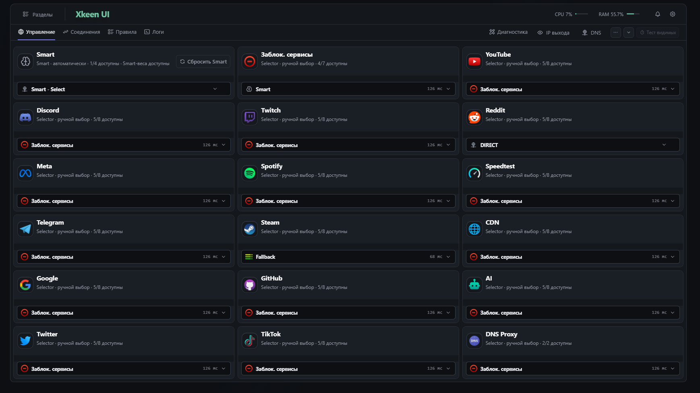
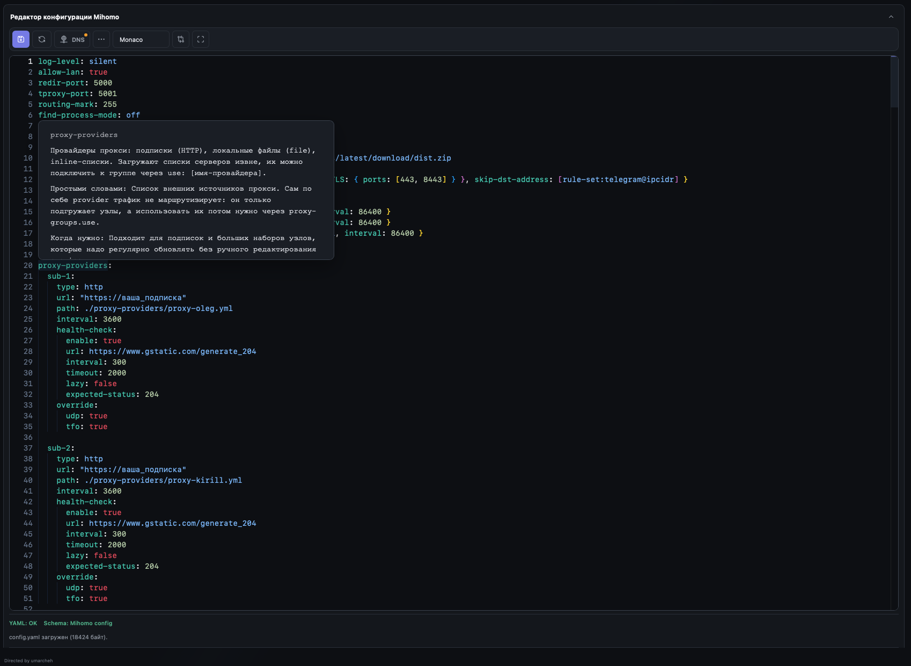
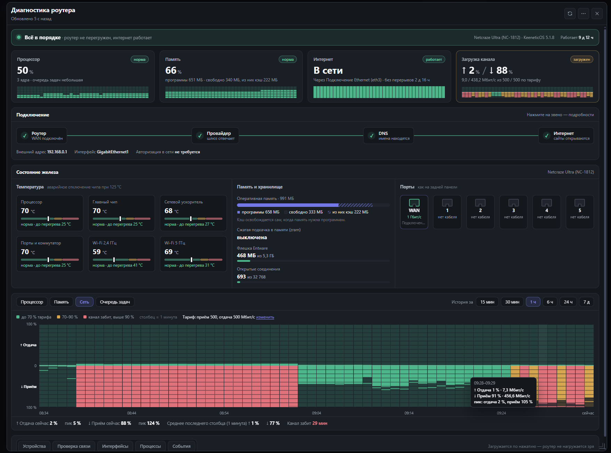
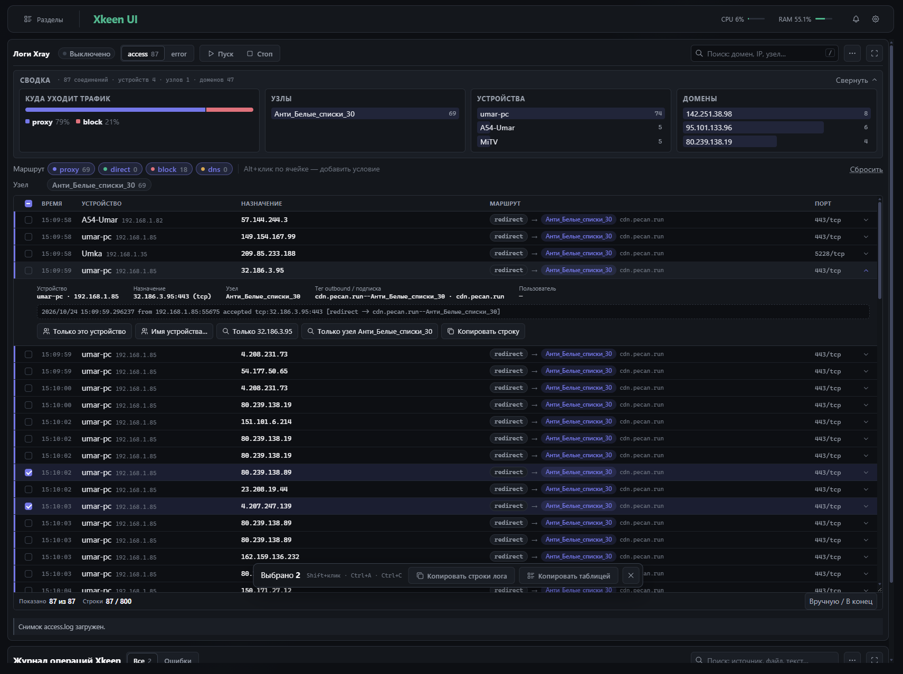

<p align="center">
  
</p>

<h1 align="center">Xkeen UI</h1>

Xkeen UI — веб-панель для управления XKeen, Xray и Mihomo на роутерах Keenetic с Entware. В одном интерфейсе можно настроить маршрутизацию, управлять ядрами и подписками, смотреть трафик и разбирать проблемы с подключением. Для Android есть отдельное beta-приложение.

> Открывайте панель только из локальной сети или через доверенный VPN. Не публикуйте её напрямую в интернете.

## Возможности

- **Xray:** редакторы Routing, Inbounds и Outbounds, подписки, группы узлов, GeoIP/GeoSite, проверка конфигурации, резервные копии и логи.
- **Mihomo:** управление группами, соединениями, правилами и провайдерами; импорт узлов и подписок, YAML-редактор, шаблоны, диагностика DNS и логи.
- Для форка Prizrak-Core поддерживаются [поля конфигурации и Remnawave Host Mapper](docs/prizrak-core.md).
- **Наблюдение:** аналитика трафика, диагностика роутера, состояние CPU, памяти, интернет-канала и событий, поиск и фильтры в логах Xray.
- **Инструменты:** файловый менеджер, терминал, команды, настройки и обновление панели через DevTools.
- **Гибкая установка:** полный набор модулей, минимальный профиль для Xray или Mihomo либо собственный состав. Редакторы и frontend-ресурсы поставляются вместе с панелью; Node.js на роутере не нужен.

## Скриншоты

Управление группами Mihomo:

[](assets/readme/mihomo-groups.png)

| YAML-редактор Mihomo                                                                                | Диагностика роутера                                                                                                  |
| --------------------------------------------------------------------------------------------------- | -------------------------------------------------------------------------------------------------------------------- |
| [](assets/readme/mihomo-editor.png) | [](assets/readme/router-diagnostics.png) |

Логи Xray и сводка соединений:

[](assets/readme/xray-logs.png)

## Установка

Нужен роутер Keenetic с Entware и доступом по SSH.

### Быстрый старт

Скачайте архив [последнего стабильного выпуска](https://github.com/umarcheh001/Xkeen-UI/releases/latest) и запустите установщик на роутере:

```sh
cd /opt
curl -fL -o xkeen-ui-routing.tar.gz "https://github.com/umarcheh001/Xkeen-UI/releases/latest/download/xkeen-ui-routing.tar.gz"
tar -xzf xkeen-ui-routing.tar.gz
cd xkeen-ui
sh install.sh
```

### Из скачанного архива

Если архив уже скачан вручную, перенесите `xkeen-ui-routing.tar.gz` в `/opt` роутера и выполните:

```sh
cd /opt
tar -xzf xkeen-ui-routing.tar.gz
cd xkeen-ui
sh install.sh
```

Установщик предложит профиль и дополнительные компоненты, поставит необходимые зависимости и покажет адрес панели. Порт по умолчанию — `8088`; если он занят, используется `8091` или свободный порт из диапазона `8100–8199`. При обновлении сохраняется выбранный профиль и пользовательские конфигурации. Новые beta-версии находятся на [странице выпусков](https://github.com/umarcheh001/Xkeen-UI/releases).

Для установки без выбора профиля в меню:

```sh
XKEEN_UI_INSTALL_PROFILE=xray-minimal sh install.sh
XKEEN_UI_INSTALL_PROFILE=mihomo-minimal sh install.sh
```

Запускайте одну из этих команд вместо обычного `sh install.sh` из распакованного каталога. Профиль `full` выбирается по умолчанию; состав `custom` и правила обновления описаны в [документации профилей](docs/modular-panel-stage7-installer-profiles.md).

После установки откройте `http://<IP-роутера>:<порт>/` и создайте учётную запись. Обновлять панель можно из DevTools или повторным запуском установщика из нового архива.

## Полезные команды

Управление службой на роутере:

```sh
/opt/etc/init.d/S99xkeen-ui-umarcheh001 status
/opt/etc/init.d/S99xkeen-ui-umarcheh001 restart
/opt/etc/init.d/S99xkeen-ui-umarcheh001 stop
/opt/etc/init.d/S99xkeen-ui-umarcheh001 start
```

На старых установках init-скрипт может называться `/opt/etc/init.d/S99xkeen-ui`.

```sh
tail -f /opt/var/log/xkeen-ui.log          # журнал панели
tail -f /opt/var/log/xkeen-ui-install.log  # журнал установки
```

Если нужно заново создать логин и пароль, остановите службу, удалите файл авторизации и запустите её снова:

```sh
/opt/etc/init.d/S99xkeen-ui-umarcheh001 stop
rm -f /opt/etc/xkeen-ui/auth.json
/opt/etc/init.d/S99xkeen-ui-umarcheh001 start
```

## Удаление

```sh
sh /opt/etc/xkeen-ui/uninstall.sh
```

Деинсталлятор предложит выбрать режим. Для запуска без вопросов укажите его в команде:

```sh
sh /opt/etc/xkeen-ui/uninstall.sh --keep-data  # сохранить данные для следующей установки
sh /opt/etc/xkeen-ui/uninstall.sh --purge      # удалить панель и её данные
```

В обоих режимах скрипт останавливает службу, отключает защиту DNS, удаляет программу панели, её init-скрипт, команды, журналы и служебные файлы. `--keep-data` сохраняет настройки и пароль панели, подписки, ключи, пользовательские шаблоны, корзину файлового менеджера и резервные копии конфигов. `--purge` удаляет также эти данные и библиотеки Python, установленные самой панелью. Без интерактивного терминала и без ключа данные сохраняются.

Рабочие конфиги Xray и Mihomo, DAT-файлы и пакеты Entware остаются. Если защиту DNS не удалось отключить, удаление прерывается и служба запускается снова; `--force` позволяет продолжить удаление в этом случае.

## Android

[Xkeen Mobile Beta](https://github.com/umarcheh001/Xkeen-UI/releases) — отдельный клиент для Android 9+. APK `xkeen-mobile-beta.apk` публикуется в выпусках; возможности и текущее состояние приложения описаны в [android-companion/README.md](android-companion/README.md). Используйте APK вместе с актуальной версией панели.

## Разработка

Для локальной сборки нужны Node.js 20+, npm и Python с зависимостями из `requirements-dev.txt`:

```sh
npm ci
python3 -m pip install -r requirements-dev.txt
npx playwright install chromium
```

| Команда                     | Назначение                                                                                 |
| --------------------------- | ------------------------------------------------------------------------------------------ |
| `npm run frontend:verify`   | Собрать и проверить frontend.                                                              |
| `npm run test:py`           | Запустить Python-тесты, включая отдельный прогон тестов времени.                           |
| `npm run e2e:smoke`         | Запустить быстрые браузерные проверки.                                                     |
| `npm run inventory:refresh` | Обновить генерируемые описи после изменений; новые файлы сначала добавьте через `git add`. |
| `npm run inventory:check`   | Сверить описи с содержимым индекса Git.                                                    |
| `npm run archive:user`      | Собрать установочный архив.                                                                |

Порядок подготовки beta и стабильных выпусков — в [RELEASING.md](RELEASING.md). Подробная документация панели — в [docs/README.md](docs/README.md).
