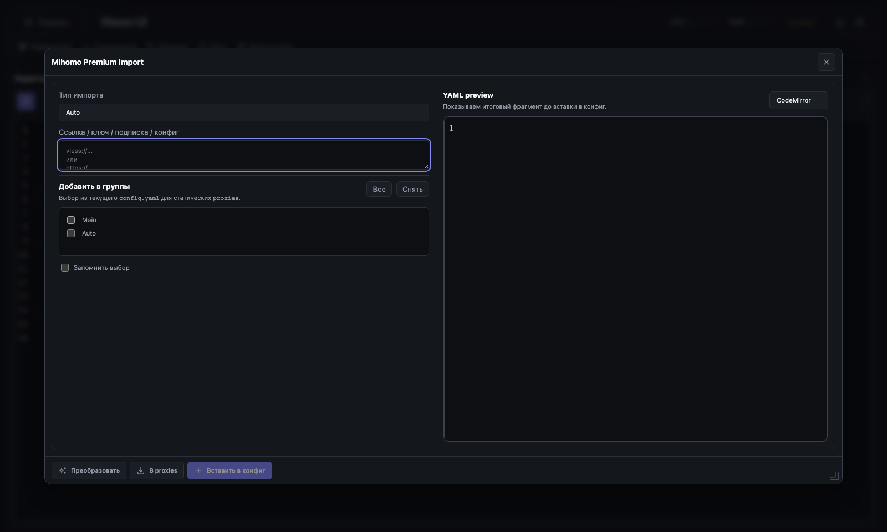
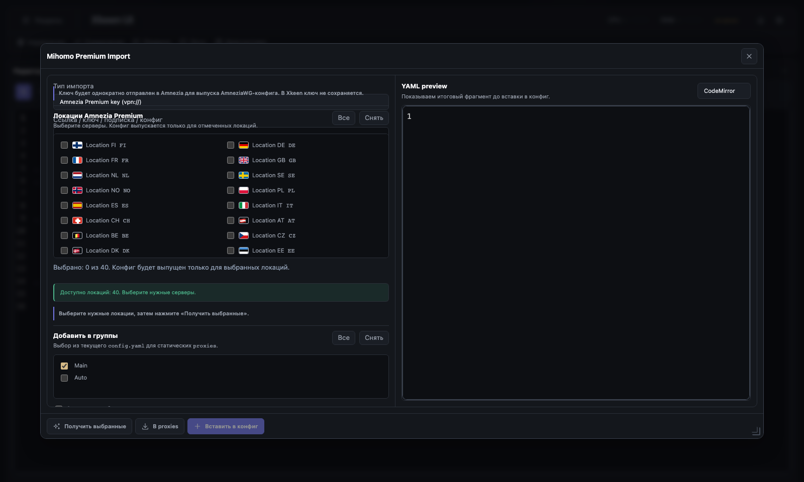
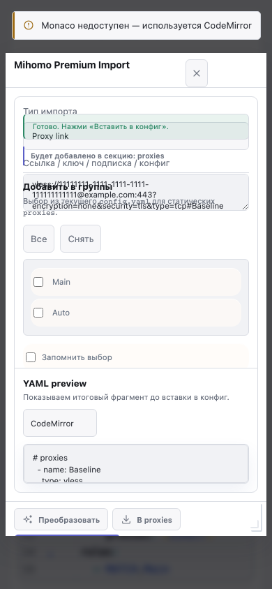

# Mihomo «Узел»: закрытие Этапа 0 — Baseline и инвентаризация

**Закрыт:** 26 октября 2026 года. **База:** `pre-release`, `0eece0cefab92b1d4eaa969b950a559d7d4d281d`.

Это фиксация **текущего**, а не целевого поведения. Production-файлы `xkeen-ui/` в Этапе 0 не менялись. Следующий этап — UX-контракт и component-level Operator prototype, затем state/API extraction.

## 1. Методика и границы

- Disposable Flask E2E server, Chromium Playwright 1.59.1, Node 24.16.0, Python 3.11.15; профиль модулей `full`, source ESM, macOS.
- Основной конфиг синтетический: `Main`, `Auto`, пустые `proxies`, `proxy-providers`, правило `MATCH,Main`.
- Direct VLESS парсится текущим web-кодом; WireGuard/OpenVPN/Tailscale — настоящими локальными parser routes. Xray/provider/Amnezia remote responses подменены безопасными fixtures.
- `/api/mihomo/patch/apply_insert` в итоговом batch capture настоящий: возвращает patched draft, не сохраняет файл. Регистрация подписок подменена; `POST /api/mihomo-config`, save/restart и command paths блокируются.
- `E2E_BASE_URL` запрещён harness-ом, чтобы нельзя было случайно направить baseline на роутер. Реальные ключи, provider credentials и пользовательские конфиги не читались.
- Timings — единичные wall-clock samples с Playwright auto-wait и локальным HTTP. Это не p95, не production SLO и не сравнение скорости реального роутера. 27 editor-related requests относятся ко всему startup-пути панели до открытия, а не только модалу.
- Начальные screenshots `current-*` снимались с дефолтным disposable config без групп. Последующий characterization использует явный fixture с группами. Это разные, обозначенные preconditions.

## 2. Реальные screenshots

Снимки сделаны с работающего приложения, не с прототипов плана. Полные PNG лежат в `docs/mihomo-node-import-baseline/`. При длинном содержимом снимок показывает viewport, а не весь прокручиваемый документ; для списка Amnezia есть отдельный capture нижнего края. Известные геометрические дефекты не ретушировались.

| Файл | Preconditions / состояние |
| --- | --- |
| `desktop-dark-empty.png` | Dark, 1600×960, CodeMirror, пустой preview, fixture-группы |
| `desktop-dark-single.png` | Auto/VLESS, выбран `Main`, валидный YAML |
| `desktop-dark-error.png` | Неподдержанная synthetic ссылка |
| `desktop-dark-mixed-batch.png` | Две valid proxy-ссылки + одна unsupported |
| `desktop-dark-provider.png` | URL → fallback provider preview |
| `desktop-dark-provider-static.png` | «В proxies» → static provider payload, интервал обновления |
| `desktop-dark-wireguard.png` | Реальный parser AmneziaWG 3.1 fixture |
| `desktop-dark-openvpn.png` | Реальный OpenVPN parser, synthetic user/password/certificate |
| `desktop-dark-tailscale.png` | Реальный Tailscale parser, synthetic auth key |
| `desktop-dark-amnezia-locations.png`, `desktop-dark-amnezia-bottom.png` | Discovery 40 локаций, начало/конец списка, flags/fallback |
| `desktop-dark-amnezia-issued.png` | Один явный выпуск DE, повторная кнопка без повторного issuance |
| `desktop-dark-saved-geometry.png` | Реальный resize, close/reopen, persisted geometry |
| `desktop-light-empty.png`, `desktop-light-monaco.png` | Light/CM и desktop Monaco preview |
| `desktop-large-subscription-50.png` | 50 synthetic узлов, текущий preview/refresh UI |
| `mobile-dark-amnezia.png` | 390×844, один столбец локаций, текущая геометрия |
| `mobile-light-empty.png`, `mobile-light-fallback.png` | 390×844, light, CM и fault-injected no-preview-runtime |
| `desktop-short-dark-empty.png` | Короткий экран 1280×600 |
| `current-*.png` | Первичный empty/parsed/mobile/Amnezia capture без групп |

### Примеры зафиксированного интерфейса

Пустой desktop dark:



Amnezia discovery: флаги сохранены; видимое перекрытие подписей — исходный дефект:



Мобильный plain-text fallback: видимое перекрытие controls также оставлено в baseline:



## 3. Матрица источников и владельцев побочных эффектов

Общий web commit: provider патчится локально через `mihomo_yaml_patch`; static proxy — последовательно через `POST /api/mihomo/patch/apply_insert`. Итог передаётся в главный редактор, без записи config на диск. **Текущая** registration Xray/static-subscriptions выполняется до `setEditorText`, независимо от будущего сохранения на диск; это намеренно изменится в новом UX-контракте, но пока не исправляется.

| Источник/режим | Parser/adapter → output | Группы сейчас | Обновление / side-effect owner | Evidence / следующий guard |
| --- | --- | --- | --- | --- |
| `auto`, прямой VLESS | Browser `generateConfigForMihomo` → `proxy` | Selected groups → `proxies` при commit | Только editor draft; source local | Characterization single + node-import/xhttp tests |
| `proxy`, batch | Browser line parser: VLESS/VMess/Trojan/SS/Hysteria2/aliases; Tailscale URI отдельной веткой → `proxy` | `apply_insert` для каждого узла | Нет subscription registration для простых ссылок | Mixed batch, частичный успех; все протоколы в browser fixtures — test backlog для Этапа 2/4 |
| `subscription` или `auto`, Xray JSON / share-link subscription | `/api/mihomo/parse/xray-json` → `proxy[]`, `xrayBulk` | Selected groups → `proxies` | Server fetch в parse; `/subscriptions/imported-xray` сохраняет metadata при вставке | Route/conversion tests + synthetic batch 1/10/50 |
| Обычная Clash/Mihomo подписка | `not_xray_json` → `/provider/probe` → provider YAML | Provider вставляется в `proxy-providers`; group `use` import flow не патчит | Probe/fetch; provider далее обновляет ядро, default interval 43200 sec | Provider capture + native fallback tests; явный `use` — будущая работа |
| «В proxies» у provider | `/provider/probe` → `provider_proxies[]` → static | Selected groups → `proxies` | Imported subscription metadata с parser `mihomo-provider` | Static-provider capture + API consistency tests |
| Happ/HWID | Нормализация Happ, Xray attempt, provider/HWID adapter, возможный `static_happ` | Зависит от output: static `proxies` либо provider | Network/decrypt/device headers на сервере; static refresh metadata при commit | `test_mihomo_hwid_sub/routes`, Xray route tests; live provider не проверялся |
| `amnezia-premium` | `/amnezia-premium/locations` discovery → `/parse/amnezia-premium` выбранный выпуск → `proxy[]` | Selected groups → `proxies` | Только второй шаг выпускает конфиги через Amnezia; browser guard на повторный selection | Capture discovery=1, issuance=1, повтор не увеличивает; route tests с mock issuance |
| `wireguard` | Весь input → `/parse/wireguard` → `proxy` | `apply_insert` → `proxies` | Local parse, без source fetch | Real web parse + WG/AmneziaWG tests |
| `openvpn` | Весь input → `/parse/openvpn` → `proxy` | То же | Local parse; certificate/credentials входят в technical preview | Real web parse + parser/route tests |
| `tailscale` | Весь input → `/parse/tailscale` → `proxy` | То же | Local parse; это не тест входа в tailnet | Real web parse + parser/route tests |
| Native `/node/import-draft` | Server builder и callbacks → полный draft | Builder patches groups для static | Не пишет config, но опционально регистрирует subscription; Auto Amnezia имеет другой issuance path | Native route tests; не заменяет web pipeline автоматически |

**Ограничение Auto:** web Auto разбирает input построчно и не равен native autodetection WireGuard/OpenVPN. Whole-config VPN требует ручного режима. Нельзя потерять эту разницу при рефакторинге и выдать native tests за доказательство web-поведения.

## 4. Контракты совместимости

Полный список с source hashes и line references — `mihomo-node-import-baseline/source-inventory.json`.

| Контракт | Freeze до контролируемой миграции |
| --- | --- |
| Modal identity | `mihomo-import-modal`, `role=dialog`, `aria-modal=true`, `aria-label=Импорт узла Mihomo`, family `editor-workbench` |
| Source/actions | `mihomo-import-mode`, `-input`, `-parse-btn`, `-parse-static-btn`, `-insert-btn`, `-close-btn`, `-cancel-btn` |
| Preview/status | `mihomo-import-preview`, `-preview-monaco`, `-engine-select`, `-status`, `-target-hint` |
| Groups | `mihomo-import-groups`, `-groups-block`, `-groups-all-btn`, `-groups-none-btn`, `-groups-remember`, `.mihomo-import-group-cb[data-group]` |
| Amnezia | `mihomo-import-amnezia-locations*`, `.mihomo-import-amnezia-location-cb[data-location-code]`, `.xk-mi-amnezia-location-flag` |
| Managed subscriptions | `mihomo-import-xray-refresh-block`, `-xray-interval`, `-xray-managed`, `-xray-refresh-note`; update/delete/interval actions в модале не read-only |
| ESM exports | `getMihomoImportApi`, `initMihomoImport`, `openMihomoImport`, `openMihomoImportWithInput`, `generateMihomoImportConfig`, `proxyYamlRawFromIndentedMihomo`, `mihomoImportApi` |
| Feature facade | `init`, `open`, `openWithInput`, synchronous `generateConfigForMihomo`, synchronous `proxyYamlRawFromIndented` |
| Compat | `features/compat/mihomo_import.js` публикует `window.XKeen.features.mihomoImport`; canonical module сам globals не публикует |
| Consumers | Lazy binding runtime получает API; Proxy Tools вызывает synchronous generator; HWID modal вызывает `openWithInput(value,{mode:'auto'})` с auto parse |
| Open options | `mode`, `focus`; `openWithInput` также `parse:false` и `parseOptions` |
| Hotkeys | Ctrl/Cmd+Enter parse; Ctrl/Cmd+Shift+Enter insert |
| Preferences | `xkeen.mihomo.import.mode.v1`, `groups.v1`, `groups.remember_v1`, `xray_interval_hours.v1`; prefix `xkeen.mihomo.import.` |
| Geometry | Текущий shell `data-modal-key` и modal manager storage записываются capture; конкретный найденный ключ — в `characterization.json.states.savedGeometry.storage` |

### HTTP surface

- Parse: `POST /api/mihomo/parse/{wireguard,openvpn,tailscale,xray-json,amnezia-premium}`.
- Amnezia discovery: `POST /api/mihomo/amnezia-premium/locations`.
- Provider: `POST /api/mihomo/provider/probe`, serving `/mihomo/provider.yaml` и `/mihomo/hwid/provider.yaml`.
- Draft insertion: `POST /api/mihomo/patch/apply_insert`.
- Refresh metadata: `GET /api/mihomo/subscriptions`, `POST /api/mihomo/subscriptions/imported-xray`, update/delete/refresh per subscription id.
- Не вызывается текущей import-вставкой: `POST /api/mihomo-config`, save/restart/raw routes. Они относятся к будущим save/apply actions и должны переиспользовать общий safe pipeline.

## 5. Измерения

Источник геометрии: `baseline-measurements.json` и `characterization.json`. Источник batch: `batch.json`; актуальные значения следует читать из JSON, если capture воспроизведён.

| Sample | Результат |
| --- | --- |
| Desktop 1600×960 | Modal 1440×787.1875; preview 695.125×588.34375; resize handle есть |
| Mobile 390×844, исходное пустое состояние | Modal 374×692; preview 324×55 в первичном capture |
| Amnezia | 40 строк; container height 246, scrollHeight 614; 2 desktop columns; flag box 20×14, SVG 18×12 для первого флага |
| Editor runtime | Empty preview уже имеет CM; Monaco создаётся по переключению; null runtime → readonly textarea |
| Startup network | 215 request events до первого открытия в первичном capture, 27 путей совпали с editor asset filter; сюда входят стартовые модули всей панели |

Batch measured на настоящем local `apply_insert`, remote parse и registration mocked. Начальная серия 1 → 10 → 50 выполняется в одном editor session; предыдущие вставленные узлы остаются. Поэтому время зависит и от размера накопленного config. Исходный предварительный замер 3/30 в `baseline-measurements.json` дополнительно mock-ал patch и **не** является оценкой backend patch latency.

| Узлов | Parse requests | Patch requests | Metadata registration |
| --- | --- | --- | --- |
| 1 | 1 | 1 | 1 mocked |
| 10 | 1 | 10 | 1 mocked |
| 50 | 1 | 50 | 1 mocked |

В итоговом capture: открытие до visibility — 419 мс, single parse — 423 мс; batch parse/insert 1 узла — 256/336 мс, 10 — 329/408 мс, 50 — 370/1119 мс. Saved geometry после реального resize/reopen: 1177×724; фактический ключ `xk.modal.state.v1.mihomo-import-modal`. Short 1280×600: modal 1228.8×520.

Это доказывает N-request topology, а не конкретную пропускную способность роутера. Открытие (`openMs`) включает click/visibility wait; это не «время до полной готовности YAML». `textareaBackingChars=0` в Monaco не означает пустой model: backing textarea не синхронизируется при active Monaco, нужен visible model/facade.

## 6. Известные исходные дефекты и границы QA

| Наблюдение | Где подтверждено | Куда перенести |
| --- | --- | --- |
| Source changed, insert всё ещё enabled | `inputEditedAfterParse.insertStillEnabled=true` | Этап 2: result revision/invalidation |
| Ошибка содержит исходную строку | Error capture + `errors.push` в web parser | Этап 4/8: redaction |
| Provider insert не добавляет `use` в группы | `insertProvidersIntoConfig` patcher path | Этап 5 |
| Статическая provider-подписка названа «HWID», даже для ordinary fixture | Static-provider status screenshot | Этап 4/5: source-specific labels |
| Registration сохраняется до записи editor/file | `insertIntoEditor` порядок вызовов | Этап 6: pending metadata/save lifecycle |
| Высокий preview изначально пуст, но runtime активен | Empty screenshots/runtime facts | Этап 3/7: lazy preview |
| При длинных Amnezia/refresh states элементы controls местами сжимаются и подписи перекрываются | Desktop Amnezia и large-subscription screenshots | Этап 3/8: flex sizing/progressive disclosure |
| Resize viewport при открытом модале может закреплять промежуточную геометрию | Mobile → desktop capture; исправляется закрытием/reopen в harness | Этап 3: modal geometry lifecycle |
| Граница модала в viewport не гарантирует доступность всех действий: на mobile длинные controls перекрываются, кнопка вставки уходит за видимую часть footer | `mobile-dark-amnezia.png`, `mobile-light-fallback.png`; прежний narrow E2E проверяет только frame | Этап 3/8: доступность всех controls и footer, не только ширина окна |

Все это baseline, не новые регрессии. Проверки focus trap, zoom 200%, реальной экранной клавиатуры, всех протоколов в browser, race responses и live router apply **не** объявлены выполненными — их test plan уже находится в этапах 2–8. Отсутствие живого роутера не мешает закрыть inventory-этап.

## 7. Результаты проверок

| Проверка | Результат |
| --- | --- |
| Existing targeted server set | 74 passed |
| Additional xhttp/xray/HWID/API-consistency/Operator contracts | 154 passed |
| Новые inventory/harness guard tests | 2 passed |
| Existing modal layout E2E | 5 passed |
| Final opt-in characterization capture | 4 passed; см. `mihomo-node-import-baseline/test-results.json` |
| `npm run frontend:verify:static` | Passed; raw build manifests/vendor assets verified |
| `npm run inventory:check` | Passed |

Первичные ошибки авторского capture-harness устранены в harness: seed canonical ESM editor вместо предположения о загруженном legacy global; чтение полного editor model вместо виртуализированного DOM для длинного текста; actual resize/close/reopen вместо предположения о storage key. Ничего из этого не исправлялось в production code. Во время capture background resource API может возвращать 503 на disposable macOS server; это не результат parser/import операции. Полный release build и полный repo test suite для документационного этапа не запускались.

## 8. Воспроизведение

По умолчанию snapshot scripts пишут в `.tmp`, не перезаписывают исторические артефакты.

```bash
node scripts/run_python.mjs scripts/capture_mihomo_import_inventory.py

XKEEN_E2E_PORT=18490 \
  npx playwright test --config=e2e/mihomo_import_baseline.config.mjs

node scripts/run_python.mjs -m pytest -q \
  tests/test_mihomo_import_baseline_inventory.py

npx playwright test e2e/mihomo_import_modal_layout.spec.mjs --workers=1
npm run frontend:verify:static
npm run inventory:check
```

Для осознанного переснятия исторического каталога: `MIHOMO_BASELINE_DIR=docs/mihomo-node-import-baseline` перед E2E командой; для collector — `--out docs/mihomo-node-import-baseline/source-inventory.json`. После редизайна это исторический characterization, не обязательный regression gate с устаревшей геометрией.

Integrity всех PNG/JSON и source fixture/harness зафиксирована в `mihomo-node-import-baseline/artifact-manifest.json`. Каталог содержит 24 PNG; полный viewport просмотрен для ключевых пустых/ошибочных, Amnezia, Monaco, mobile и short states; contact sheets использованы для сопоставления остальных режимов. Это не утверждение, что прокручено всё содержимое каждого редактора.

**Этап 0 закрыт:** все пункты baseline/inventory выполнены; производственные изменения, state extraction и новый дизайн остаются для следующих этапов. Основной план: `../README-mihomo-node-import-redesign-plan.md`.
