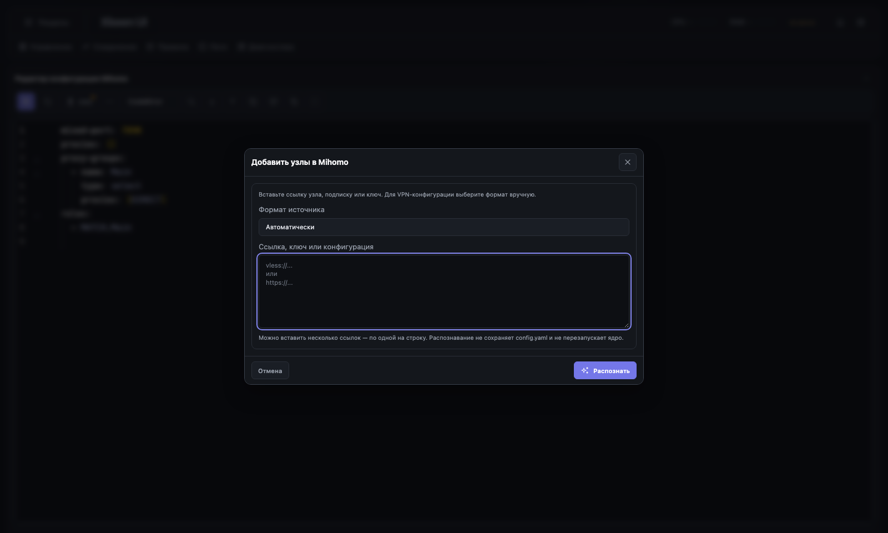
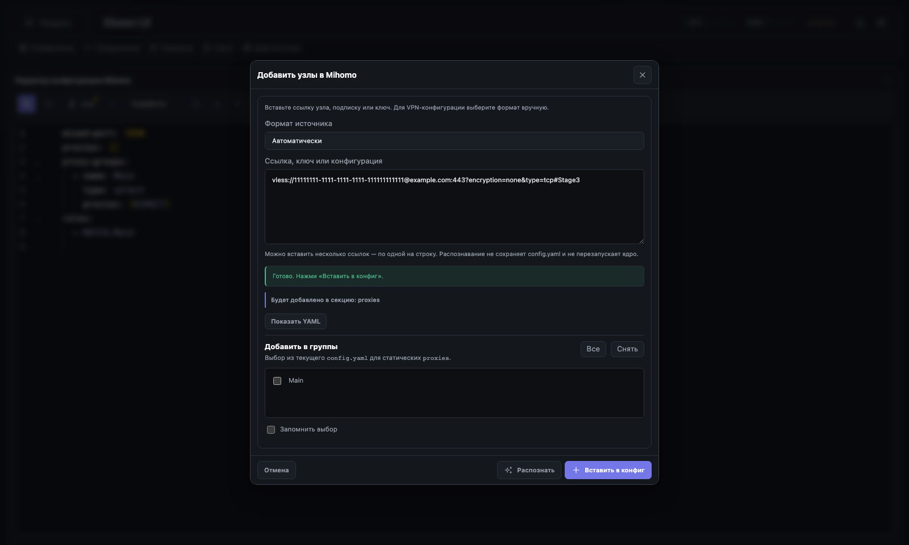
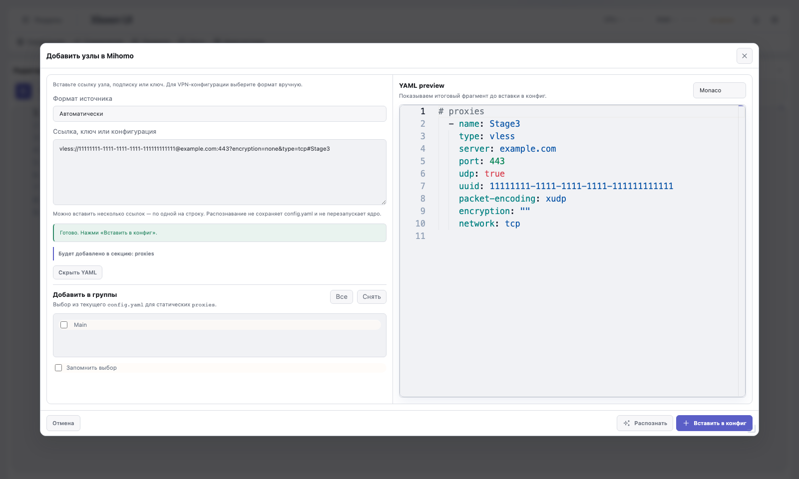
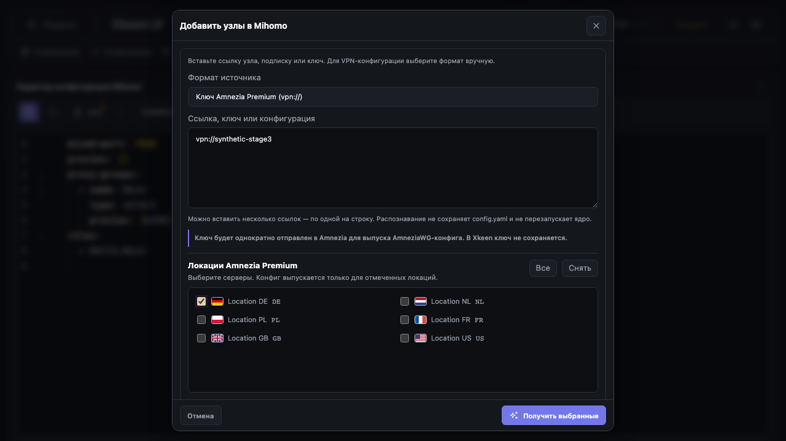
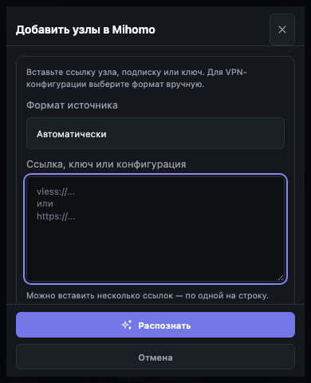
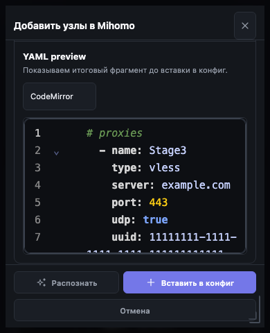

# Mihomo «Узел»: Этап 3 — компактный источник и modal lifecycle

**Закрыт:** 26 октября 2026 года. **База:** `c00b960f` (Этап 2).

В этом этапе изменён реальный web-интерфейс. Это не обновление HTML-прототипа.
Новый результат-карточки, destination redesign и save/apply ещё не реализованы:
они остаются этапами 4–6. Старые parser/adapters и вставка в editor draft сохранены.

## 1. Реальный интерфейс

### Источник: 720 px вместо большого пустого workbench



- Заголовок «Добавить узлы в Mihomo», формат «Автоматически», source textarea и «Распознать».
- В начале не видны группы, технический YAML, engine selector и вставка.
- «В proxies» остаётся контекстным действием только для URL-подписок: это временный compatibility path до Этапа 5, не удаление static-provider import.
- Managed subscription update/pause/refresh/delete/interval доступны в свёрнутом разделе при наличии записей; hidden preview для этого не загружается.
- Подсказка объясняет несколько URI по строкам и ручной mode для многострочного VPN-конфига. Само распознавание не пишет файл и не рестартует ядро.

### Результат и YAML: отдельное раскрытие



После successful parse появляется прежняя сводка, релевантные группы и «Показать YAML». CodeMirror/Monaco создаётся **только** при раскрытии, не при parse и не при открытии пустого окна.



Engine preference общая с главным редактором, не сбрасывается автоматически. Runtime unavailable → readonly textarea. Закрытие уничтожает preview instances; async runtime-load проверяет session/generation, позднее завершение не открывает закрытый preview.

### Amnezia Premium



Discovery/issuance остаются явными разными действиями. Флаги из существующего local helper, checkbox labels и ISO-коды сохранены, desktop two-column scroller продолжает работать. Discovery не открывает preview и не выпускает конфиги.

### Mobile / короткий экран





Body прокручивается отдельно от header/footer. При 390×844, 390×480 и 1280×600 основные кнопки остаются внутри viewport. Формы не сжимаются поверх статусов/списка локаций. В screenshots некоторые подсказки/группы ниже fold — доступны прокруткой; это не клиппинг данных и не обещание показать весь конфиг одновременно.

## 2. Общий modal manager

- Существующий `XKeen.ui.modal.open/close` отвечает за visibility/store/scroll lock; Escape/backdrop используют прежний request-close путь и feature close control.
- Добавлен общий `modal.refreshGeometry(modal)` для изменения формы открытого модала: reset managed inline geometry → restore remembered state, если разрешено → resize handle → viewport clamp → refresh embeds. Не создан второй manager.
- `data-mi-layout`: `source`, `result`, `preview`. В source/result geometry не запоминается и resize/drag отключены; при preview обычный resizable workbench.
- Expanded geometry имеет отдельный key `xk.modal.state.v1.mihomo-import-preview-v2`. Старый большой `...mihomo-import-modal` и прежний `...mihomo-import` не удаляются и не растягивают source.
- На возврате из preview к source/result manager сбрасывает inline width/height/position, не оставляя фиксированную desktop/mobile геометрию.
- Accessible name через `aria-labelledby`, source focus, Tab/Shift+Tab wrap, возврат фокуса на trigger/его menu summary.

## 3. Async и ошибки

- Сеть вызывается только после кнопки или Ctrl/Cmd+Enter; обычная правка input/format не делает fetch.
- Повторный hotkey во время текущего parse не создаёт второй request. Loading имеет visible status и `aria-busy`.
- Изменение source/mode инвалидирует результат, возвращает source и сохраняет сам ввод.
- Amnezia discovery и subscription list load проверяют актуальный session до изменения DOM.
- `not_xray_json` в fulfilled `{ok:false}` сохраняет `error.data`: ordinary-provider fallback не ломается после API extraction Этапа 2. Добавлены runtime adapter и browser regression tests.
- Серверный выпуск Amnezia не считается отменённым при закрытии браузерного UI. Ни новый AbortController contract, ни rollback здесь не заявлены.
- Полная безопасная модель candidate/save/apply и redaction всех ошибок — Этапы 4–6/8; текущий технический preview может содержать synthetic/пользовательские credentials, как и прежде.

## 4. Проверки и доказательства

| Проверка | Результат |
| --- | --- |
| Layout E2E | 7 passed: Amnezia flags, source/expanded resize, 390 px, toast, spinner, invalidation, late response |
| Source lifecycle E2E | 13 passed: lazy CM/Monaco/fallback, old/new geometry, dark/light, source errors, 390×844/480, 1280×600, Escape/backdrop/focus, busy hotkey, subscriptions disclosure, whole VPN text/batch, Amnezia discovery, provider fallback |
| Общий modal manager regression E2E | 5 passed: соседние HWID/validation модалы и межэкранный confirm |
| Targeted Python | 205 passed: Mihomo parser/route/API, xhttp, hotfixes, modal ownership, Operator/icons и stage contracts |
| Node unit | 7 passed: state token/revision + API metadata/options |
| Полный frontend build | `npm run frontend:verify` passed (Vite + vendor + generated manifests) |
| Syntax/whitespace | ESM `node --check`, `git diff --check` |
| Generated inventories | Обновлены штатным `inventory:refresh`; исторический Stage 0 capture не переснимался |

Screenshot-capture встроен в актуальные lifecycle tests: по умолчанию в test-results; для обновления артефактов задать `MIHOMO_STAGE3_CAPTURE_DIR=docs/mihomo-node-import-stage3`. Все источники — fixtures `example.com`, UUID-заглушки, synthetic Amnezia; API write/restart не тестировались на роутере.

```bash
node --test tests/js/mihomo_import_state.test.mjs tests/js/mihomo_import_api.test.mjs

npx playwright test e2e/mihomo_import_modal_layout.spec.mjs \
  e2e/mihomo_import_source_lifecycle.spec.mjs --workers=1

node scripts/run_python.mjs -m pytest -q \
  tests/test_mihomo_import_stage3_contract.py \
  tests/test_mihomo_feature_api_consistency.py \
  tests/test_panel_operator_stage4_mihomo_forms.py \
  tests/test_modular_panel_stage4_4_modals.py

npm run frontend:verify
```

## 5. Приёмка и ограничения

- [x] Компактный source вместо пустого workbench, текущие Operator tokens.
- [x] Lazy YAML disclosure, CM/Monaco/fallback, сохранение shared preference.
- [x] Корректный reset старой геометрии и remembered expanded workbench.
- [x] URI batch и whole-config modes сохранены, static URL path не удалён.
- [x] Existing subscriptions management доступно без parser/preview.
- [x] Реальный local E2E, build, source contracts и screenshot QA.
- [x] План и docs index содержат закрытие этапа, generated inventories синхронизированы.

**Ограничения:** 390×480 — эмуляция уменьшенного viewport, не тест физической iOS/Android экранной клавиатуры. VisualViewport-specific поведение на реальном устройстве не проверено. Просмотрены 17 PNG (contact sheets для всех, полноразмерно ключевые mobile/Monaco/Amnezia/source); все редакторы/списки не прокручивались построчно. Исторические baseline дефекты не переносятся в новые regression expectations. Production save/apply и новый result UI этим этапом не закрыты.

**Следующий этап:** Этап 4 — карточки результата и специальные источники.
