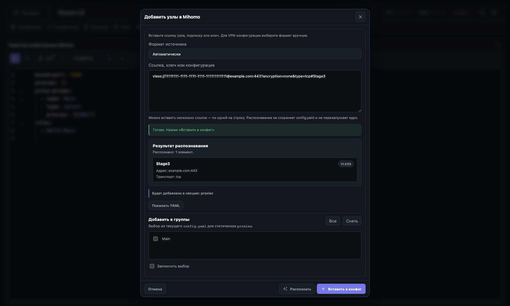

# Mihomo node import — Этап 4: карточки результата и специальные источники

**Статус:** закрыт 26 октября 2026 года.

Этап добавляет понятный, безопасный итог распознавания между source-формой и
техническим YAML. Сейчас этот итог показывается одной компактной статусной
строкой; отдельный блок карточек результата из модала убран, чтобы не дублировать
зелёную сводку и не увеличивать прокрутку. Presentation model сохраняется для
безопасного формирования этой строки и диагностик. Parser-ы, save/apply и
проверка доступности узлов по сети этим этапом не меняются.

## Реализовано

- Введена framework-free presentation model
  `xkeen-ui/static/js/features/mihomo_import_result.js`. Она принимает
  существующие parser outputs и строит DTO для UI, не изменяя конвертацию
  протоколов и API parser-ов.
- Presentation model формирует компактную сводку в статусе модала:
  - для узла — итоговое имя, тип, безопасный `host:port`, транспорт, TLS/Reality
    и явное указание секции назначения;
  - для Xray-JSON, Happ/HWID static import и provider — безопасный домен
    источника, обнаруженный формат, число полученных и пропущенных элементов,
    а также `proxies` либо `proxy-providers`;
  - для Amnezia Premium — число доступных/выбранных локаций до выпуска и число
    выданных конфигураций после явного запроса.
- Карточка отдельно показывает занятoe имя и предложенное новое имя. Похожее
  соединение в текущем `config.yaml` обозначается отдельным warning и не
  смешивается с конфликтом имени.
- Частичный успех выводит безопасное число пропусков и diagnostic list. Ошибка
  не печатает исходную ссылку, query string, credentials, UUID, password или
  ключи; неизвестный результат не выдаётся за «0 узлов». Для blocked и
  unsupported источников используются отдельные outcome-сообщения.
- Для сводки применяется Operator-style text-only DOM rendering через
  `textContent`, compact wording и dark/light совместимые tokens. Ввод и
  technical YAML по-прежнему могут содержать необходимые секреты и не
  подменяются обещанием полной redaction.

## Специальные источники

- **Amnezia Premium:** локальные SVG-флаги, ISO fallback, двухколоночный
  desktop/одноколоночный mobile scroller и выбор локаций сохранены. Выпуск
  конфигураций остаётся отдельным явным нажатием; повторный выпуск для того же
  набора блокируется существующим selection key.
- **Xray-JSON:** карточка обозначает static `proxies` flow и pending
  автообновление без выдумывания следующего запуска.
- **Happ/HWID:** карточка сообщает совместимый static flow и не раскрывает
  HWID/заголовки.
- **Обычная HTTPS-подписка:** карточка различает provider и static import,
  показывает только безопасный domain/port, не URL/path/query.

## Проверки

- Unit: `node --test tests/js/mihomo_import_result.test.mjs`.
- Playwright: карточки node/subscription/partial error, safe diagnostics,
  conflict name и duplicate connection.
- Существующие lifecycle/layout проверки сохраняют lazy preview, geometry,
  флаги Amnezia и keyboard/modal behaviour.
- `npm run frontend:build`, `npm run frontend:verify:static` и generated
  inventories выполняются после изменения surfaces.

## Граница этапа

Этап не сохраняет `config.yaml`, не перезапускает Mihomo и не добавляет новую
проверку доступности/latency. Явное назначение provider/static, группы,
автообновление и save/apply остаются задачами Этапов 5–6.
