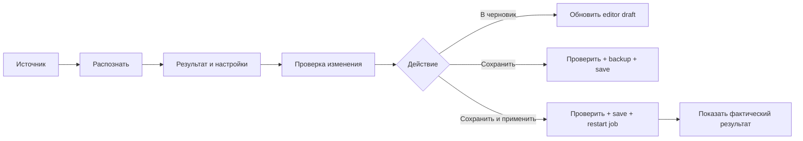
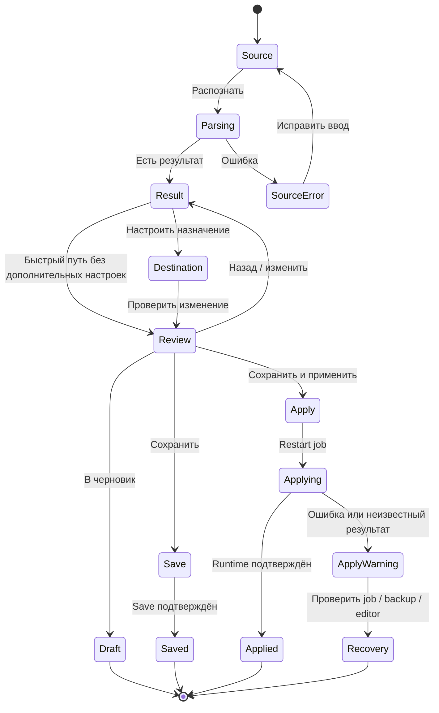

# Mihomo «Узел»: UX-контракт и границы v1

**Этап:** 1 — «Утвердить UX и границы первой версии»  
**Статус:** закрыт 26 октября 2026 года  
**Основание:** закрытый baseline Этапа 0, commit `e320d34e`  
**Production implementation:** не начата этим документом

**Interactive component prototype:** `mihomo-node-import-ux-prototype.html` — локальный, без save/restart/network side effects.

> Этот документ фиксирует продуктовые решения для реализации. Он не является
> описанием уже работающего интерфейса. Все данные в прототипах демонстрационные.

## 1. Решение v1

Модал называется **«Добавить узлы в Mihomo»**. Он остаётся одним модалом с
progressive disclosure. Отдельные вкладки «Узел / Подписка / Конфигурация» в v1
не добавляем: режим `Авто` определяет источник, а ручной override остаётся в
select.

Основной путь:



### 1.1. Состояния

Внешне видны три шага. Loading, error и partial success являются состояниями
текущего шага и не создают отдельные страницы.



### 1.2. Основные действия

| Действие | Разрешённый side effect | Сообщение об успехе |
| --- | --- | --- |
| **Распознать** | Parse/discovery; для Amnezia — только список локаций | «Источник распознан» |
| **Получить выбранные** | Amnezia issuance только для отмеченных локаций | «Конфигурации получены» |
| **В черновик** | Изменить текст редактора, поставить dirty state; не писать файл | «Добавлено в черновик» |
| **Сохранить** | Проверить candidate, backup, записать `config.yaml`, `restart: false` | «Конфиг сохранён» |
| **Сохранить и применить** | Проверить candidate, backup, записать, запустить restart job, проверить результат | «Конфиг применён» или конкретный partial/unknown status |
| **Отмена / закрытие** | Не применять candidate; server-side job не отменять | Закрыть без скрытого действия |

`Сохранить` не наследует глобальную настройку авторестарта. `Сохранить и
применить` не повторяет parse, issuance или insertion. После закрытия во время
restart job его мониторинг можно восстановить по `job_id`.

## 2. Границы первой версии

### 2.1. Входит в v1

- Все текущие source modes: `Auto`, proxy link, HTTPS subscription, Amnezia
  Premium, WireGuard/AmneziaWG, OpenVPN, Tailscale.
- Один узел и многострочный batch proxy links.
- Xray JSON subscription с массовым static import.
- Обычная Clash/Mihomo subscription как provider, если provider adapter её
  поддерживает.
- Static import для provider payload, если probe явно возвращает такой режим.
- Amnezia Premium с выбором локаций, count, flags, «Все / Снять» и явным
  выпуском выбранных конфигураций.
- Группы `proxy-groups` для static `proxies`.
- Provider groups через `use`, только с корректным provider contract.
- Три финальных действия: draft, save-only, save-and-apply.
- Summary и technical YAML/diff disclosure.
- Partial parse с числом валидных/пропущенных элементов и явным подтверждением.
- Full candidate revision check перед draft/save/apply.
- Dark/light Operator style, 390px, short viewport, keyboard navigation,
  CodeMirror/Monaco/fallback.

### 2.2. Не входит в v1

- Новая отдельная страница каталога provider-ов.
- Выбор отдельных узлов из большой подписки. В v1 импортируются все валидные
  узлы; individual selection — P2.
- Проверка доступности, latency или реальное подключение каждого узла.
- Импорт любого полного Mihomo profile как отдельная функция.
- Автоматический restart после обычного `Сохранить`.
- Автоматический rollback при любом restart failure, если существующий backup
  restore не был явно выбран пользователем.
- Переработка Android UI.
- Замена серверных parser-ов или перенос web flow на native draft route.

### 2.3. Источник истины по текущим контрактам

Реализация обязана переиспользовать:

- текущий modal manager и Operator tokens;
- `getMihomoImportApi()` и compat facade;
- существующие parser/provider adapters;
- общий Mihomo editor API;
- raw config save/backup/restart job pipeline панели.

Новый importer не должен имитировать клики главного toolbar и не должен
вызывать generator endpoint, требующий generator state.

## 3. Поведение по источникам

| Источник | Результат v1 | Настройки | Финальный destination |
| --- | --- | --- | --- |
| Один proxy link | Карточка одного узла | имя, группы | `proxies` |
| Batch proxy links | Список валидных узлов + skipped count | имя/группы на batch; без individual selection | `proxies` |
| Xray JSON subscription | количество узлов, skipped count, safe domain | группы, interval, refresh metadata | static `proxies` + managed metadata |
| Clash/Mihomo provider | provider profile, supported mode, warnings | provider name, interval, groups via `use` | `proxy-providers` |
| Static provider payload | число узлов и источник | группы, interval, managed metadata | `proxies` |
| Amnezia Premium | список локаций с flags и count | выбрать locations | `proxies` после explicit issuance |
| WireGuard/AmneziaWG | одна карточка VPN-конфига | имя, группы | `proxies` |
| OpenVPN | одна карточка VPN-конфига | имя, группы | `proxies` |
| Tailscale | одна карточка Tailscale-конфига | имя, группы | `proxies` |

### 3.1. Auto не расширяет поддержку молча

Web `Auto` в текущем importer-е разбирает обычные URI построчно. Whole-config
WireGuard/OpenVPN/Tailscale остаётся явным ручным mode. Native
`/api/mihomo/node/import-draft` не становится автоматической заменой web flow.

Если source не соответствует выбранному mode, интерфейс оставляет ввод и
показывает конкретную причину. Не переключает mode молча.

### 3.2. Partial success

Partial success разрешён только после явного подтверждения:

```text
Распознано 47 узлов. 3 строки пропущены.
Причины: неподдерживаемый формат — 2; пустая строка — 1.
Будут добавлены только 47 валидных узлов.

[Назад] [Показать строки] [Продолжить с 47 узлами]
```

- Ошибка одного элемента не маскируется как полный success.
- В summary показываются counts и безопасные причины.
- Retry не скачивает источник и не выпускает Amnezia повторно без изменения
  source/selection.
- Ошибка save/apply не является partial parse: она получает отдельный статус
  `not saved`, `saved but not applied` или `unknown outcome`.

## 4. Operator UI contract

### 4.1. Визуальная система

Production UI обязан использовать:

- `--op-*` tokens из `xkeen-ui/static/panel-operator.css`;
- существующий modal manager, sticky footer и scroll behavior;
- существующие buttons, inputs, checkbox/radio/select, status rows и icons;
- локальные SVG-флаги через `mihomoCountryFlag()` / `countryFlag()`;
- dark/light theme и доступный focus/hover/disabled/busy state;
- no hardcoded replacement theme и no new CDN assets.

Pencil-прототипы ниже фиксируют компонентную иерархию и текст. Интерактивный HTML-прототип использует те же Operator tokens, modal shell, button/status patterns и responsive footer; он не заменяет production CSS или pixel-perfect QA.

### 4.2. Source state

```pencil
{
  "version": "2.21",
  "children": [{
    "id": "source",
    "type": "frame",
    "width": 880,
    "height": 500,
    "layout": "none",
    "clip": true,
    "fill": "#14171c",
    "stroke": "#2a2f38",
    "strokeWidth": 1,
    "cornerRadius": 9,
    "children": [
      { "id": "line", "type": "rectangle", "x": 0, "y": 55, "width": 880, "height": 1, "fill": "#2a2f38" },
      { "id": "title", "type": "text", "x": 22, "y": 18, "width": 620, "height": 24, "content": "Добавить узлы в Mihomo", "fontSize": 15, "fontWeight": "600", "fill": "#f7f7f9" },
      { "id": "close", "type": "text", "x": 830, "y": 18, "width": 28, "height": 22, "content": "×", "fontSize": 16, "fill": "#969da9" },
      { "id": "lead", "type": "text", "x": 22, "y": 78, "width": 820, "height": 20, "content": "Ссылка, подписка, ключ Amnezia или VPN-конфигурация", "fontSize": 13, "fill": "#969da9" },
      { "id": "panel", "type": "rectangle", "x": 22, "y": 116, "width": 836, "height": 285, "fill": "#1a1e25", "stroke": "#2a2f38", "strokeWidth": 1, "cornerRadius": 9 },
      { "id": "label", "type": "text", "x": 44, "y": 138, "width": 260, "height": 20, "content": "Источник", "fontSize": 14, "fontWeight": "600", "fill": "#f7f7f9" },
      { "id": "mode", "type": "rectangle", "x": 44, "y": 170, "width": 330, "height": 34, "fill": "#0d0f13", "stroke": "#3a414d", "strokeWidth": 1, "cornerRadius": 6 },
      { "id": "modeText", "type": "text", "x": 56, "y": 179, "width": 292, "height": 18, "content": "Авто — определить автоматически     ⌄", "fontSize": 13, "fill": "#e8eaf0" },
      { "id": "inputLabel", "type": "text", "x": 44, "y": 226, "width": 420, "height": 20, "content": "Ссылка, ключ или конфигурация", "fontSize": 13, "fill": "#e8eaf0" },
      { "id": "input", "type": "rectangle", "x": 44, "y": 254, "width": 792, "height": 108, "fill": "#0d0f13", "stroke": "#3a414d", "strokeWidth": 1, "cornerRadius": 6 },
      { "id": "placeholder", "type": "text", "x": 56, "y": 268, "width": 740, "height": 50, "content": "vless://…\nили\nhttps://…", "fontSize": 13, "fill": "#969da9" },
      { "id": "hint", "type": "text", "x": 44, "y": 376, "width": 780, "height": 18, "content": "На этом шаге config.yaml не сохраняется и Mihomo не перезапускается.", "fontSize": 12, "fill": "#969da9" },
      { "id": "cancel", "type": "frame", "x": 650, "y": 436, "width": 90, "height": 34, "layout": "none", "fill": "#1a1e25", "stroke": "#2a2f38", "strokeWidth": 1, "cornerRadius": 6, "children": [{ "id": "cancelText", "type": "text", "x": 20, "y": 8, "width": 50, "height": 18, "content": "Отмена", "fontSize": 13, "fill": "#e8eaf0" }] },
      { "id": "parse", "type": "frame", "x": 748, "y": 436, "width": 110, "height": 34, "layout": "none", "fill": "#7477e8", "stroke": "#7477e8", "strokeWidth": 1, "cornerRadius": 6, "children": [{ "id": "parseText", "type": "text", "x": 24, "y": 8, "width": 64, "height": 18, "content": "Распознать", "fontSize": 13, "fontWeight": "600", "fill": "#f7f7f9" }] }
    ]
  }]
}
```

### 4.3. Result/destination state

```pencil
{
  "version": "2.21",
  "children": [{
    "id": "result",
    "type": "frame",
    "width": 1040,
    "height": 570,
    "layout": "none",
    "clip": true,
    "fill": "#14171c",
    "stroke": "#2a2f38",
    "strokeWidth": 1,
    "cornerRadius": 9,
    "children": [
      { "id": "line", "type": "rectangle", "x": 0, "y": 55, "width": 1040, "height": 1, "fill": "#2a2f38" },
      { "id": "title", "type": "text", "x": 22, "y": 18, "width": 780, "height": 24, "content": "Результат распознавания", "fontSize": 15, "fontWeight": "600", "fill": "#f7f7f9" },
      { "id": "summary", "type": "text", "x": 22, "y": 80, "width": 996, "height": 22, "content": "VLESS · найден 1 узел · доступность сервера не проверялась", "fontSize": 13, "fontWeight": "600", "fill": "#6fd3a8" },
      { "id": "card", "type": "rectangle", "x": 22, "y": 124, "width": 480, "height": 190, "fill": "#1a1e25", "stroke": "#2a2f38", "strokeWidth": 1, "cornerRadius": 9 },
      { "id": "node", "type": "text", "x": 42, "y": 148, "width": 420, "height": 24, "content": "Germany-01", "fontSize": 15, "fontWeight": "600", "fill": "#f7f7f9" },
      { "id": "details", "type": "text", "x": 42, "y": 190, "width": 420, "height": 70, "content": "example.com:443\nTLS · Reality · TCP\nКонфликт имени не обнаружен", "fontSize": 13, "fill": "#e8eaf0" },
      { "id": "destination", "type": "rectangle", "x": 524, "y": 124, "width": 494, "height": 190, "fill": "#1a1e25", "stroke": "#2a2f38", "strokeWidth": 1, "cornerRadius": 9 },
      { "id": "destTitle", "type": "text", "x": 546, "y": 148, "width": 400, "height": 22, "content": "Куда добавить", "fontSize": 14, "fontWeight": "600", "fill": "#f7f7f9" },
      { "id": "static", "type": "text", "x": 546, "y": 188, "width": 430, "height": 20, "content": "●  Статический узел → proxies", "fontSize": 13, "fill": "#e8eaf0" },
      { "id": "groups", "type": "text", "x": 546, "y": 228, "width": 430, "height": 50, "content": "Добавить в группы\n☑ Auto-Fallback   ☑ Ru-Traffic", "fontSize": 13, "fill": "#e8eaf0" },
      { "id": "notice", "type": "rectangle", "x": 22, "y": 340, "width": 996, "height": 70, "fill": "#20252d", "stroke": "#3a414d", "strokeWidth": 1, "cornerRadius": 9 },
      { "id": "noticeText", "type": "text", "x": 42, "y": 360, "width": 950, "height": 32, "content": "На финальном шаге доступны: в черновик, сохранить или сохранить и применить.\nВесь candidate включает текущие несохранённые правки редактора.", "fontSize": 12, "fill": "#b1b7c2" },
      { "id": "back", "type": "frame", "x": 808, "y": 508, "width": 92, "height": 34, "layout": "none", "fill": "#1a1e25", "stroke": "#2a2f38", "strokeWidth": 1, "cornerRadius": 6, "children": [{ "id": "backText", "type": "text", "x": 24, "y": 8, "width": 44, "height": 18, "content": "Назад", "fontSize": 13, "fill": "#e8eaf0" }] },
      { "id": "review", "type": "frame", "x": 910, "y": 508, "width": 108, "height": 34, "layout": "none", "fill": "#7477e8", "stroke": "#7477e8", "strokeWidth": 1, "cornerRadius": 6, "children": [{ "id": "reviewText", "type": "text", "x": 17, "y": 8, "width": 74, "height": 18, "content": "Проверить", "fontSize": 13, "fontWeight": "600", "fill": "#f7f7f9" }] }
    ]
  }]
}
```

### 4.4. Review/apply state

```pencil
{
  "version": "2.21",
  "children": [{
    "id": "review",
    "type": "frame",
    "width": 1040,
    "height": 650,
    "layout": "none",
    "clip": true,
    "fill": "#14171c",
    "stroke": "#2a2f38",
    "strokeWidth": 1,
    "cornerRadius": 9,
    "children": [
      { "id": "line", "type": "rectangle", "x": 0, "y": 55, "width": 1040, "height": 1, "fill": "#2a2f38" },
      { "id": "title", "type": "text", "x": 22, "y": 18, "width": 850, "height": 24, "content": "Проверка изменения", "fontSize": 15, "fontWeight": "600", "fill": "#f7f7f9" },
      { "id": "summary", "type": "text", "x": 22, "y": 80, "width": 996, "height": 22, "content": "Черновик: +1 узел · +2 ссылки в группах · файл на роутере не изменён", "fontSize": 13, "fontWeight": "600", "fill": "#6fd3a8" },
      { "id": "warning", "type": "rectangle", "x": 22, "y": 120, "width": 996, "height": 62, "fill": "#20252d", "stroke": "#e2b463", "strokeWidth": 1, "cornerRadius": 9 },
      { "id": "warningText", "type": "text", "x": 42, "y": 137, "width": 950, "height": 30, "content": "Сохранение запишет весь итоговый config.yaml, включая другие несохранённые правки.", "fontSize": 12, "fontWeight": "600", "fill": "#e2b463" },
      { "id": "overview", "type": "rectangle", "x": 22, "y": 208, "width": 392, "height": 286, "fill": "#0d0f13", "stroke": "#2a2f38", "strokeWidth": 1, "cornerRadius": 9 },
      { "id": "overviewTitle", "type": "text", "x": 42, "y": 228, "width": 340, "height": 20, "content": "Итог операции", "fontSize": 14, "fontWeight": "600", "fill": "#f7f7f9" },
      { "id": "overviewBody", "type": "text", "x": 42, "y": 270, "width": 340, "height": 140, "content": "Новый узел: Germany-01\nГруппы: Auto-Fallback, Ru-Traffic\nAuto-update: не требуется\nBackup: перед записью", "fontSize": 13, "fill": "#e8eaf0" },
      { "id": "diff", "type": "rectangle", "x": 430, "y": 208, "width": 588, "height": 286, "fill": "#0d0f13", "stroke": "#2a2f38", "strokeWidth": 1, "cornerRadius": 9 },
      { "id": "diffTitle", "type": "text", "x": 450, "y": 228, "width": 540, "height": 20, "content": "Изменения YAML · раскрыто по запросу", "fontSize": 14, "fontWeight": "600", "fill": "#f7f7f9" },
      { "id": "diffBody", "type": "text", "x": 450, "y": 270, "width": 540, "height": 150, "content": "+ proxies: Germany-01\n+ Auto-Fallback.proxies: Germany-01\n+ Ru-Traffic.proxies: Germany-01\n\nИмпорт — часть полного сохраняемого candidate", "fontSize": 13, "fill": "#b1b7c2" },
      { "id": "note", "type": "text", "x": 22, "y": 520, "width": 996, "height": 22, "content": "До подтверждения config.yaml на роутере не меняется.", "fontSize": 12, "fill": "#969da9" },
      { "id": "draft", "type": "frame", "x": 464, "y": 588, "width": 126, "height": 34, "layout": "none", "fill": "#1a1e25", "stroke": "#2a2f38", "strokeWidth": 1, "cornerRadius": 6, "children": [{ "id": "draftText", "type": "text", "x": 18, "y": 8, "width": 90, "height": 18, "content": "В черновик", "fontSize": 13, "fill": "#e8eaf0" }] },
      { "id": "save", "type": "frame", "x": 602, "y": 588, "width": 118, "height": 34, "layout": "none", "fill": "#1a1e25", "stroke": "#2a2f38", "strokeWidth": 1, "cornerRadius": 6, "children": [{ "id": "saveText", "type": "text", "x": 29, "y": 8, "width": 60, "height": 18, "content": "Сохранить", "fontSize": 13, "fill": "#e8eaf0" }] },
      { "id": "apply", "type": "frame", "x": 732, "y": 588, "width": 286, "height": 34, "layout": "none", "fill": "#7477e8", "stroke": "#7477e8", "strokeWidth": 1, "cornerRadius": 6, "children": [{ "id": "applyText", "type": "text", "x": 68, "y": 8, "width": 150, "height": 18, "content": "Сохранить и применить", "fontSize": 13, "fontWeight": "600", "fill": "#f7f7f9" }] }
    ]
  }]
}
```

## 5. Интерактивный component prototype

Откройте `mihomo-node-import-ux-prototype.html` локально или через статический
сервер. Переключатель `Scenario` показывает source, result, Amnezia с SVG-флагами,
review и apply-result. Переключатель темы проверяет dark/light. В прототипе нет
вызовов API, записи файла, restart и хранения credentials.

Проверить вручную:

- desktop и mobile viewport;
- footer и три финальные кнопки;
- partial/unknown apply result;
- Amnezia flags, ISO-коды и checkbox labels;
- keyboard focus на select, textarea, checkboxes и buttons.

## 6. Продуктовые правила

### 5.1. Секреты и приватность

- Source textarea — временное поле. Не писать source, private key, token, URL
  credentials в localStorage, history, analytics или console.
- Summary показывает safe domain, protocol, port и redacted metadata.
- Technical YAML disclosure явно предупреждает, что credential fields могут быть
  видны пользователю самому себе.
- Error copy не повторяет полный source line, если в нём есть credential.
- Logs save/apply redacted; server logs не становятся частью UI без redaction.

### 5.2. Unsaved editor changes

Перед `Сохранить` и `Сохранить и применить` показываем, что будет записан весь
candidate. Проверяем editor revision и file baseline. При конфликте:

```text
Config изменился после подготовки preview.
Проверка устарела. Обновить candidate и проверить снова?

[Отмена] [Пересобрать preview]
```

Не разрешаем silent overwrite. `В черновик` может изменить editor draft, но не
помечает его clean.

### 5.3. Save/apply result contract

| Состояние | Обязательный текст | Следующее действие |
| --- | --- | --- |
| Candidate invalid | «Конфиг не сохранён» + line/diagnostic | исправить или назад |
| Save failed | «Файл не сохранён» | повторить save после причины |
| Saved, no restart | «Конфиг сохранён» | открыть editor / закрыть |
| Restart running | «Применение выполняется» + job id | monitor; закрытие не отменяет job |
| Restart failed | «Файл сохранён, но применение не подтверждено» | проверить job / backup / editor |
| Unknown | «Результат применения неизвестен» | проверить состояние, не повторять импорт |
| Applied | «Конфиг применён» + проверенное состояние | закрыть / открыть editor |

Нельзя показывать «Успешно» только по HTTP 202 или наличию `job_id`.

## 7. Acceptance checklist Этапа 1

- [x] Название, основной путь и три финальных действия зафиксированы.
- [x] Режим Auto и ручные modes зафиксированы без скрытого переключения.
- [x] Семь текущих source modes и их destinations описаны.
- [x] Provider/static/use/group boundaries зафиксированы.
- [x] Amnezia flags, location selection и explicit issuance зафиксированы.
- [x] Partial parse и partial apply имеют разные контракты.
- [x] Unsaved editor changes и revision conflict имеют явный UX.
- [x] Secrets, logs и technical YAML disclosure имеют правила.
- [x] v1 и P2 boundaries зафиксированы.
- [x] Operator tokens, modal shell, accessibility и responsive contract зафиксированы.
- [x] Component-level Pencil prototypes проверены через `blueprint4llm`.

**Этап 1 закрыт.** Следующий этап — выделение state/API adapters без визуальной
переписи (`Этап 2` в основном плане). Production implementation должна начинаться
с этого контракта и не переоткрывать закрытые продуктовые решения без отдельного
решения пользователя.
